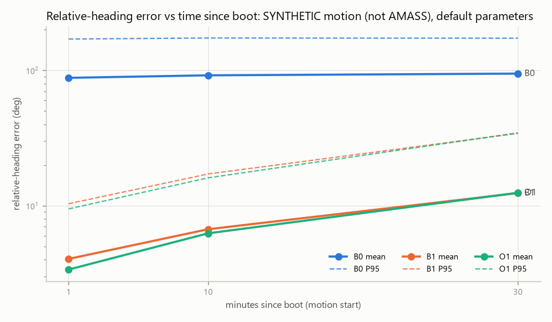

# Step 1 results: baselines B0, B1, O1, O2

> **PROVISIONAL: SYNTHETIC MOTION, NOT AMASS.** These numbers come from the simulator driven by simple
> synthetic walking, turning-in-a-circle and standing clips (`mesqsim/synth.py`), because AMASS was not
> downloaded yet. They show that the pipeline runs end to end and how large each baseline's error is
> under the **assumed** parameters. They are not results about human motion. Rerun
> `python scripts/make_results.py` after the AMASS download to replace them.

*Generated by `python scripts/make_results.py` (`--source synthetic --seed 1`). Do not edit by hand.*

**Run:** 2026-10-23 07:52 UTC; commit `441be49ed5cb`; config hash `b083b87e8724`; seed 1; default run folder `run_g441be49_cb083b87e_s1`.

## Picture first

Every joint's relative heading δ (how far the child pod's north has slid from its parent's) is estimated by
four baselines and compared with the truth at every 32 Hz step of the motion:

- **B0** does nothing;
- **B1** registers the pods in the box;
- **O1** knows the true initial offsets;
- **O2** knows the truth.

The motion starts 1, 10 or 30 minutes after the pods were switched on, so the tables show how the error
grows with time since boot.

## Parameter set

Default configuration ([configs/default.yaml](../configs/default.yaml)); all 40+ parameters with labels:
`python -m mesqsim params`. The ones that drive these numbers:

| parameter | value | label |
|---|---|---|
| `error_model.offset_mode` | arbitrary | assumption |
| `error_model.box_slot_deg` | 2.0 | assumption |
| `error_model.drift_sigma_deg_per_min` | 0.2 | assumption |
| `error_model.scale_factor_max` | 0.015 | datasheet |
| `error_model.arw_deg_per_sqrt_s` | 0.015 | datasheet |
| `error_model.tilt_sigma_deg` | 0.5 | assumption |
| `error_model.reboot_rate_per_h` | 0.0 | assumption |
| `error_model.idle_turns_sigma_per_sqrt_min` | 0.5 | assumption |
| `timing.stall_ms` | 0.0 | assumption |
| `radio.loss_mean` | 0.02 | assumption |
| `radio.burst_mean_frames` | 3.0 | assumption |
| `dataset.window_s` | 20.0 | assumption |
| `dataset.motion_start_min` | [1, 10, 30] | assumption |

**Data:** 72 sessions from 12 source sequences (synthetic), splits test 2, train 8, val 2 (sequences). Baselines have no fitted parameters, so every split is scored; nothing is trained in Step 1. Errors are over the motion phase, all 14 joints, every 32 Hz step. Steps within a session are strongly correlated, so the independent unit is the **session** (column `sessions`): differences between baselines smaller than a few tenths of a degree are within sampling noise.

## Table 1: primary metric, relative-heading error |wrap(δ̂ − δ)| (degrees)

| baseline | min since boot | mean | median | p95 | sessions | steps |
|---|---|---|---|---|---|---|
| B0 | 1 | 88.10 | 84.08 | 170.51 | 24 | 15384 |
| B0 | 10 | 91.96 | 94.15 | 173.58 | 24 | 15384 |
| B0 | 30 | 94.68 | 96.03 | 172.99 | 24 | 15384 |
| B1 | 1 | 4.04 | 3.14 | 10.34 | 24 | 15384 |
| B1 | 10 | 6.70 | 5.25 | 17.16 | 24 | 15384 |
| B1 | 30 | 12.40 | 9.78 | 34.25 | 24 | 15384 |
| O1 | 1 | 3.37 | 2.68 | 9.47 | 24 | 15384 |
| O1 | 10 | 6.25 | 5.02 | 16.07 | 24 | 15384 |
| O1 | 30 | 12.46 | 10.10 | 34.55 | 24 | 15384 |
| O2 | 1 | 0.00 | 0.00 | 0.00 | 24 | 15384 |
| O2 | 10 | 0.00 | 0.00 | 0.00 | 24 | 15384 |
| O2 | 30 | 0.00 | 0.00 | 0.00 | 24 | 15384 |

## Table 2: by joint type (mean / P95, degrees)

| joint_type | baseline | 1 min | 10 min | 30 min |
|---|---|---|---|---|
| 2dof | B0 | 80.65 / 167.41 | 97.34 / 176.26 | 97.09 / 170.71 |
| 2dof | B1 | 4.12 / 10.55 | 6.74 / 15.97 | 14.24 / 39.83 |
| 2dof | O1 | 3.27 / 8.79 | 6.41 / 17.03 | 13.78 / 36.95 |
| 3dof | B0 | 90.60 / 170.89 | 88.55 / 172.89 | 92.70 / 169.61 |
| 3dof | B1 | 4.20 / 9.86 | 6.62 / 17.44 | 9.86 / 25.56 |
| 3dof | O1 | 3.59 / 9.80 | 6.11 / 16.30 | 10.42 / 26.46 |
| hinge | B0 | 102.93 / 173.30 | 86.06 / 168.62 | 93.38 / 175.95 |
| hinge | B1 | 3.36 / 8.46 | 6.81 / 16.58 | 14.51 / 39.51 |
| hinge | O1 | 3.06 / 8.65 | 6.18 / 14.79 | 14.64 / 41.79 |

O2 is 0 everywhere by construction (check 12.1).

## Table 3: secondary metric, parent-relative orientation error (degrees, true mountings)

Includes fusion tilt error and quantisation, so even O2 is not zero here.

| baseline | min since boot | mean | median | p95 | sessions | steps |
|---|---|---|---|---|---|---|
| B0 | 1 | 88.10 | 84.00 | 170.20 | 24 | 15384 |
| B0 | 10 | 91.97 | 94.14 | 174.07 | 24 | 15384 |
| B0 | 30 | 94.68 | 96.37 | 172.61 | 24 | 15384 |
| B1 | 1 | 4.32 | 3.45 | 10.45 | 24 | 15384 |
| B1 | 10 | 6.84 | 5.45 | 17.26 | 24 | 15384 |
| B1 | 30 | 12.49 | 9.95 | 34.61 | 24 | 15384 |
| O1 | 1 | 3.67 | 2.86 | 9.47 | 24 | 15384 |
| O1 | 10 | 6.42 | 5.08 | 16.16 | 24 | 15384 |
| O1 | 30 | 12.55 | 10.17 | 34.55 | 24 | 15384 |
| O2 | 1 | 1.13 | 1.09 | 1.97 | 24 | 15384 |
| O2 | 10 | 1.14 | 1.09 | 2.01 | 24 | 15384 |
| O2 | 30 | 1.13 | 1.08 | 1.96 | 24 | 15384 |

## Table 4: one-at-a-time sweeps (mean / P95 of the primary metric, degrees)

Motion at 10 min since boot, one window per sequence. Every other parameter at its default; the same
session seeds for every value. Run folders: `run_g441be49_cecb245a7_s1`, `run_g441be49_cbf35e7a1_s1`, `run_g441be49_c96d6860e_s1`, ….

| parameter | value | B0 | B1 | O1 |
|---|---|---|---|---|
| error_model.offset_mode | aligned | 6.60 / 16.61 | 6.55 / 16.74 | 6.41 / 16.31 |
| error_model.offset_mode | arbitrary | 89.52 / 170.17 | 6.99 / 17.53 | 6.43 / 16.31 |
| error_model.box_slot_deg | 0.50 | 89.52 / 170.16 | 6.43 / 16.31 | 6.43 / 16.32 |
| error_model.box_slot_deg | 2.00 | 89.52 / 170.17 | 6.99 / 17.53 | 6.43 / 16.31 |
| error_model.box_slot_deg | 5.00 | 89.52 / 170.20 | 8.70 / 21.89 | 6.43 / 16.31 |
| error_model.drift_sigma_deg_per_min | 0.05 | 89.46 / 171.58 | 6.51 / 15.76 | 6.11 / 15.26 |
| error_model.drift_sigma_deg_per_min | 0.20 | 89.52 / 170.17 | 6.99 / 17.53 | 6.43 / 16.31 |
| error_model.drift_sigma_deg_per_min | 1.00 | 89.34 / 170.68 | 13.08 / 31.10 | 12.60 / 31.58 |
| error_model.scale_factor_max | 0.01 | 89.52 / 170.17 | 6.99 / 17.53 | 6.43 / 16.31 |
| error_model.scale_factor_max | 0.03 | 90.47 / 172.55 | 12.56 / 32.05 | 12.30 / 31.10 |
| error_model.reboot_rate_per_h | 1.00 | 87.49 / 173.23 | 29.89 / 144.84 | 5.74 / 15.56 |
| error_model.reboot_rate_per_h | 0.00 | 89.52 / 170.17 | 6.99 / 17.53 | 6.43 / 16.31 |
| timing.stall_ms | 0.00 | 89.52 / 170.17 | 6.99 / 17.53 | 6.43 / 16.31 |
| timing.stall_ms | 50.00 | 89.52 / 170.17 | 6.99 / 17.52 | 6.43 / 16.31 |
| timing.stall_ms | 100.00 | 89.52 / 170.17 | 6.99 / 17.53 | 6.43 / 16.31 |
| timing.stall_ms | 200.00 | 89.52 / 170.17 | 6.99 / 17.54 | 6.43 / 16.31 |
| radio.loss_mean | 0.05 | 89.52 / 170.17 | 6.99 / 17.53 | 6.43 / 16.31 |
| radio.loss_mean | 0.01 | 89.52 / 170.17 | 6.99 / 17.53 | 6.43 / 16.31 |
| radio.loss_mean | 0.02 | 89.52 / 170.17 | 6.99 / 17.53 | 6.43 / 16.31 |
| radio.burst_mean_frames | 1.00 | 89.52 / 170.17 | 6.99 / 17.54 | 6.43 / 16.31 |
| radio.burst_mean_frames | 3.00 | 89.52 / 170.17 | 6.99 / 17.53 | 6.43 / 16.31 |
| radio.burst_mean_frames | 10.00 | 89.52 / 170.17 | 6.99 / 17.52 | 6.43 / 16.31 |

## Figures

*Mean (solid) and P95 (dashed) relative-heading error of B0, B1 and O1 against minutes since boot. Log scale; O2 is 0.*

*Mean error of B1 and O1 for each value of each swept parameter.*

## How to read these numbers

- B0 against B1 shows what box registration buys: in the arbitrary offset mode almost everything; in the aligned mode almost nothing (Table 4, `offset_mode`).
- O1 against B1 is the box registration's own error (slot error, plus what accrued before the box).
- O1 against O2 is the drift, turning and noise that a Step 2 estimator must track. It grows with time since boot.
- Every *assumption* row in the parameter table is a guess until Danyal's bench measurements replace it. The sweeps show how much each guess matters.
