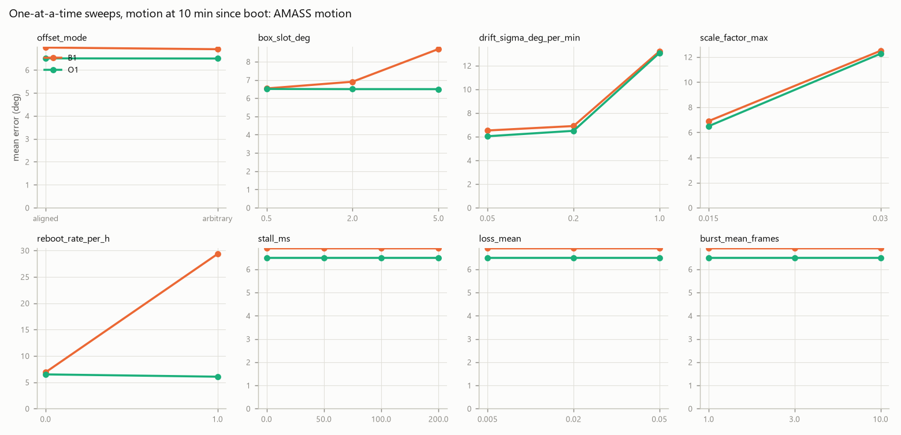

# Step 1 results: baselines B0, B1, O1, O2

> **AMASS motion, assumed parameters.** 38 of the 44 parameters are assumptions until the bench measures them
> (`python -m mesqsim params`), so these numbers describe the configured model of the suit, not the
> real suit. Split manifest SHA-256 `d36448adb76762251668b9940933e8a14df664ad6d3277fe3a930f7d55049fb3`.

*Generated by `python scripts/make_results.py` (`--source amass --seed 1 --runs-commit 2432062`). Do not edit by hand.*

**Run:** 2026-11-15 08:09 UTC; runs simulated and scored at commit `24320626a0c1` (mesqsim/ and configs/ unchanged since), report written at commit `1b400e311675`; config hash `b083b87e8724`; seed 1; default run folder `run_g2432062_cb083b87e_s1`.

## Picture first

Every joint's relative heading δ (how far the child pod's north has slid from its parent's) is estimated by
four baselines and compared with the truth at every 32 Hz step of the motion:

- **B0** does nothing;
- **B1** registers the pods in the box;
- **O1** knows the true initial offsets;
- **O2** knows the truth.

The motion starts 1, 10 or 30 minutes after the pods were switched on, so the tables show how the error
grows with time since boot.

## Parameter set

Default configuration ([configs/default.yaml](../configs/default.yaml)); all 40+ parameters with labels:
`python -m mesqsim params`. The ones that drive these numbers:

| parameter | value | label |
|---|---|---|
| `error_model.offset_mode` | arbitrary | assumption |
| `error_model.box_slot_deg` | 2.0 | assumption |
| `error_model.drift_sigma_deg_per_min` | 0.2 | assumption |
| `error_model.scale_factor_max` | 0.015 | datasheet |
| `error_model.arw_deg_per_sqrt_s` | 0.015 | datasheet |
| `error_model.tilt_sigma_deg` | 0.5 | assumption |
| `error_model.reboot_rate_per_h` | 0.0 | assumption |
| `error_model.idle_turns_sigma_per_sqrt_min` | 0.5 | assumption |
| `timing.stall_ms` | 0.0 | assumption |
| `radio.loss_mean` | 0.02 | assumption |
| `radio.burst_mean_frames` | 3.0 | assumption |
| `dataset.window_s` | 20.0 | assumption |
| `dataset.motion_start_min` | [1, 10, 30] | assumption |

**Data:** 3501 sessions from 767 source sequences of 81 subjects (amass); per split, sequences / subjects: test 117 / 15, train 572 / 57, val 78 / 9. Baselines have no fitted parameters, so every split is scored; nothing is trained in Step 1. Errors are over the motion phase, all 14 joints, every 32 Hz step. Steps within a session are strongly correlated, and sessions of one subject share that person's motion, so the independent unit is the **subject**; the `sessions` column counts sessions, not independent observations. Step 1 computes no intervals; the Step 2 analysis plan bootstraps over subjects.

## Table 1: primary metric, relative-heading error |wrap(δ̂ − δ)| (degrees)

| baseline | min since boot | mean | median | p95 | sessions | steps |
|---|---|---|---|---|---|---|
| B0 | 1 | 89.83 | 89.97 | 170.94 | 1167 | 748047 |
| B0 | 10 | 90.21 | 89.72 | 171.06 | 1167 | 748047 |
| B0 | 30 | 90.74 | 90.60 | 171.70 | 1167 | 748047 |
| B1 | 1 | 4.03 | 3.33 | 10.16 | 1167 | 748047 |
| B1 | 10 | 6.99 | 5.53 | 18.30 | 1167 | 748047 |
| B1 | 30 | 12.06 | 9.65 | 31.49 | 1167 | 748047 |
| O1 | 1 | 3.26 | 2.62 | 8.46 | 1167 | 748047 |
| O1 | 10 | 6.55 | 5.06 | 17.63 | 1167 | 748047 |
| O1 | 30 | 11.81 | 9.48 | 30.86 | 1167 | 748047 |
| O2 | 1 | 0.00 | 0.00 | 0.00 | 1167 | 748047 |
| O2 | 10 | 0.00 | 0.00 | 0.00 | 1167 | 748047 |
| O2 | 30 | 0.00 | 0.00 | 0.00 | 1167 | 748047 |

## Table 2: by joint type (mean / P95, degrees)

| joint_type | baseline | 1 min | 10 min | 30 min |
|---|---|---|---|---|
| 2dof | B0 | 89.64 / 170.73 | 90.43 / 170.56 | 89.86 / 171.51 |
| 2dof | B1 | 4.07 / 10.34 | 6.97 / 18.27 | 11.93 / 31.21 |
| 2dof | O1 | 3.28 / 8.58 | 6.56 / 17.42 | 11.71 / 30.60 |
| 3dof | B0 | 89.83 / 170.44 | 90.39 / 171.92 | 91.33 / 171.41 |
| 3dof | B1 | 3.99 / 10.05 | 7.00 / 18.36 | 12.12 / 32.02 |
| 3dof | O1 | 3.23 / 8.38 | 6.53 / 17.77 | 11.89 / 31.16 |
| hinge | B0 | 90.40 / 172.48 | 88.99 / 170.11 | 91.59 / 172.98 |
| hinge | B1 | 4.01 / 9.84 | 6.98 / 18.32 | 12.25 / 30.89 |
| hinge | O1 | 3.27 / 8.34 | 6.58 / 18.03 | 11.88 / 30.63 |

O2 is 0 everywhere by construction (check 12.1).

## Table 3: secondary metric, parent-relative orientation error (degrees, true mountings)

Includes fusion tilt error and quantisation, so even O2 is not zero here.

| baseline | min since boot | mean | median | p95 | sessions | steps |
|---|---|---|---|---|---|---|
| B0 | 1 | 89.85 | 89.93 | 170.95 | 1167 | 748047 |
| B0 | 10 | 90.22 | 89.74 | 171.08 | 1167 | 748047 |
| B0 | 30 | 90.75 | 90.59 | 171.69 | 1167 | 748047 |
| B1 | 1 | 4.28 | 3.52 | 10.27 | 1167 | 748047 |
| B1 | 10 | 7.16 | 5.65 | 18.40 | 1167 | 748047 |
| B1 | 30 | 12.16 | 9.70 | 31.52 | 1167 | 748047 |
| O1 | 1 | 3.56 | 2.86 | 8.65 | 1167 | 748047 |
| O1 | 10 | 6.73 | 5.17 | 17.74 | 1167 | 748047 |
| O1 | 30 | 11.92 | 9.56 | 30.88 | 1167 | 748047 |
| O2 | 1 | 1.13 | 1.09 | 1.98 | 1167 | 748047 |
| O2 | 10 | 1.14 | 1.09 | 1.99 | 1167 | 748047 |
| O2 | 30 | 1.15 | 1.09 | 1.98 | 1167 | 748047 |

## Table 4: one-at-a-time sweeps (mean / P95 of the primary metric, degrees)

Motion at 10 min since boot, one window per sequence. Every other parameter at its default; the same
session seeds for every value. Run folders: `run_g2432062_cecb245a7_s1`, `run_g2432062_cbf35e7a1_s1`, `run_g2432062_c96d6860e_s1`, ….

| parameter | value | B0 | B1 | O1 |
|---|---|---|---|---|
| error_model.offset_mode | aligned | 6.96 / 18.34 | 6.97 / 18.34 | 6.50 / 17.55 |
| error_model.offset_mode | arbitrary | 90.73 / 171.26 | 6.90 / 18.28 | 6.50 / 17.54 |
| error_model.box_slot_deg | 0.5 | 90.73 / 171.27 | 6.53 / 17.66 | 6.50 / 17.56 |
| error_model.box_slot_deg | 2 | 90.73 / 171.26 | 6.90 / 18.28 | 6.50 / 17.54 |
| error_model.box_slot_deg | 5 | 90.72 / 171.25 | 8.69 / 22.12 | 6.49 / 17.56 |
| error_model.drift_sigma_deg_per_min | 0.05 | 90.70 / 171.45 | 6.53 / 17.77 | 6.04 / 16.89 |
| error_model.drift_sigma_deg_per_min | 0.2 | 90.73 / 171.26 | 6.90 / 18.28 | 6.50 / 17.54 |
| error_model.drift_sigma_deg_per_min | 1 | 90.83 / 170.52 | 13.22 / 32.53 | 13.08 / 31.96 |
| error_model.scale_factor_max | 0.015 | 90.73 / 171.26 | 6.90 / 18.28 | 6.50 / 17.54 |
| error_model.scale_factor_max | 0.03 | 90.68 / 171.07 | 12.50 / 34.54 | 12.26 / 34.12 |
| error_model.reboot_rate_per_h | 1 | 91.31 / 171.42 | 29.33 / 146.72 | 6.06 / 16.89 |
| error_model.reboot_rate_per_h | 0 | 90.73 / 171.26 | 6.90 / 18.28 | 6.50 / 17.54 |
| timing.stall_ms | 0 | 90.73 / 171.26 | 6.90 / 18.28 | 6.50 / 17.54 |
| timing.stall_ms | 50 | 90.73 / 171.26 | 6.90 / 18.28 | 6.50 / 17.54 |
| timing.stall_ms | 100 | 90.73 / 171.26 | 6.90 / 18.28 | 6.50 / 17.54 |
| timing.stall_ms | 200 | 90.73 / 171.26 | 6.90 / 18.28 | 6.50 / 17.54 |
| radio.loss_mean | 0.05 | 90.73 / 171.26 | 6.90 / 18.29 | 6.50 / 17.54 |
| radio.loss_mean | 0.005 | 90.73 / 171.26 | 6.90 / 18.29 | 6.50 / 17.54 |
| radio.loss_mean | 0.02 | 90.73 / 171.26 | 6.90 / 18.28 | 6.50 / 17.54 |
| radio.burst_mean_frames | 1 | 90.73 / 171.26 | 6.90 / 18.29 | 6.50 / 17.54 |
| radio.burst_mean_frames | 3 | 90.73 / 171.26 | 6.90 / 18.28 | 6.50 / 17.54 |
| radio.burst_mean_frames | 10 | 90.73 / 171.26 | 6.90 / 18.28 | 6.50 / 17.54 |

## Figures

*Mean (solid) and P95 (dashed) relative-heading error of B0, B1 and O1 against minutes since boot. Log scale; O2 is 0.*

*Mean error of B1 and O1 for each value of each swept parameter.*

## How to read these numbers

- B0 against B1 shows what box registration buys: in the arbitrary offset mode almost everything; in the aligned mode almost nothing (Table 4, `offset_mode`).
- O1 against B1 is the box registration's own error (slot error, plus what accrued before the box).
- O1 against O2 is the drift, turning and noise that a Step 2 estimator must track. It grows with time since boot.
- Every *assumption* row in the parameter table is a guess until Danyal's bench measurements replace it. The sweeps show how much each guess matters.
