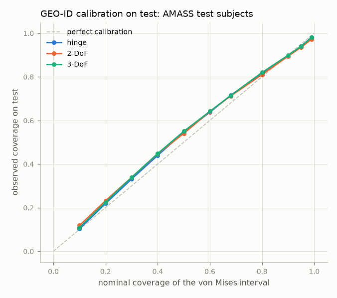
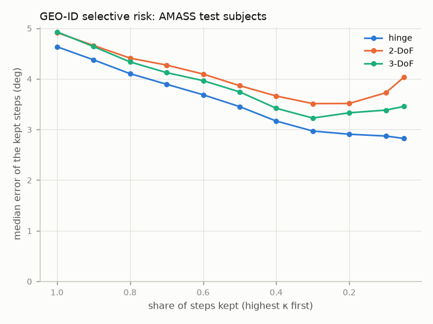
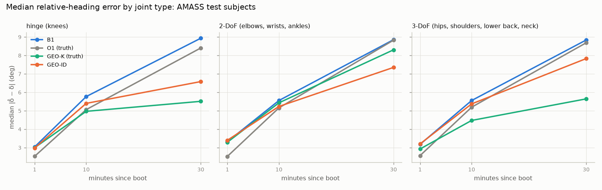
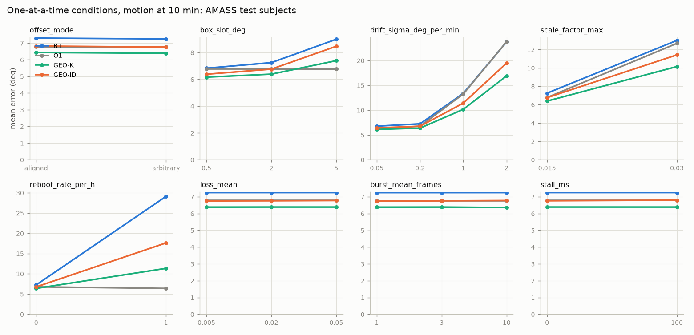
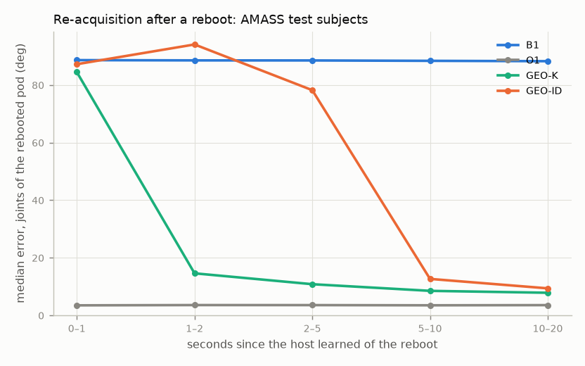
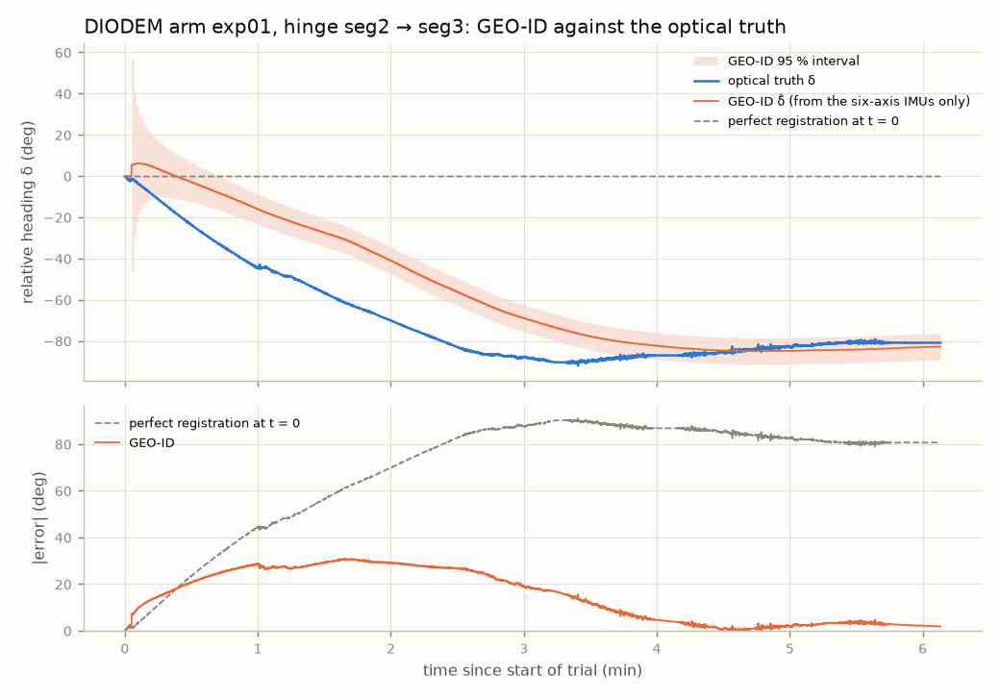

# Step 2 results: the geometric estimator (GEO-K, GEO-ID) against the Step 1 baselines

> **AMASS motion, assumed suit parameters, descriptive.** 63 of the 94 parameters are assumptions until the bench measures them and 25 are fitted (train / validation only). The split manifest (SHA-256 `d36448adb767…`) and the analysis plan are **not frozen yet** (Danyal), so every comparison
> below is **descriptive**: the intervals and Holm-adjusted p-values are computed as the draft plan says,
> but no confirmatory claim is made. Simulated sessions: the numbers describe the configured model of the
> suit.

*Generated by `python scripts/make_results_step2.py` (`--source amass --seed 1`). Do not edit by hand. Same config and seed: identical file apart from the Run line (check 33.1).*

**Run:** 2026-11-18 13:24 UTC · Apple M2 Pro · 18.5 min · GEO-ID compute: median 0.853 ms per 32 Hz step for all 14 joints (P95 1.209 ms, 519 sessions).

**Code and data:** commit `d6c048728bbc`; config hash `393036382add`; seed 1; 519 test sessions from 117 sequences of 15 subjects (amass); motion starts 1, 10, 30 min after boot.

## Picture first

Every joint's relative heading δ — how far the child pod's north has slid from its parent's — is estimated by
each method at every 32 Hz step of the motion and compared with the simulator's truth. **B1** registers the
pods in the box; **GEO-ID** is the deployable geometry: knee hinge axes identified from motion (tied to the
T-pose), range of motion at the other joints in T-pose frames, a von Mises filter with its own confidence κ.
**GEO-K** is the same geometry with the simulator's true axes and mountings: a ceiling, never deployable.

| method | what it is | uses simulator truth |
|---|---|---|
| B0 | no correction | no |
| B1 | box registration | no |
| O1 | true offsets at boot (oracle) | **yes** |
| O2 | true δ (oracle; its error is 0 by construction) | **yes** |
| GEO-K | geometry with known axes and mountings | **yes** (axes, mountings) |
| GEO-ID | deployable geometry: identified axes, T-pose frames, filter | no |
| GEO-ID-nofilter | GEO-ID, each window alone (box registration without information) | no |
| GEO-ID-hinge | GEO-ID solving the knees only; every other joint keeps its box estimate | no |
| GEO-ID-w4, GEO-ID-w16 | GEO-ID with 4 s and 16 s windows (8 s default) | no |

Methods marked `*` in the tables use simulator truth.

## Parameter set

| parameter | value | label |
|---|---|---|
| `error_model.offset_mode` | arbitrary | assumption |
| `error_model.box_slot_deg` | 2 | assumption |
| `error_model.drift_sigma_deg_per_min` | 0.2 | assumption |
| `error_model.scale_factor_max` | 0.015 | datasheet |
| `error_model.tilt_sigma_deg` | 0.5 | assumption |
| `error_model.reboot_rate_per_h` | 0 | assumption |
| `radio.loss_mean` | 0.02 | assumption |
| `dataset.window_s` | 20 | assumption |
| `dataset.motion_start_min` | [1, 10, 30] | assumption |
| `geometry.window_s` | 8 | assumption |
| `geometry.step_s` | 1 | assumption |
| `geometry.kappa_scale.hinge` | 0.011776 | fitted |
| `geometry.kappa_scale.2dof` | 0.556852 | fitted |
| `geometry.kappa_scale.3dof` | 3.72825 | fitted |
| `geometry.model_sigma_deg.hinge` | 0.9385 | fitted |
| `geometry.model_sigma_deg.2dof` | 3 | assumption |
| `geometry.model_sigma_deg.3dof` | 20.6758 | fitted |
| `geometry.drift_q_rad2_per_s` | 5.623e-05 | fitted |
| `geometry.kappa_hold` | 158.489 | fitted |

## Table 1: primary metric, |wrap(δ̂ − δ)| over all 14 joints (degrees)

| method | min since boot | mean | median | p95 | sessions |
|---|---|---|---|---|---|
| B0 | 1 | 90.36 | 90.30 | 171.67 | 173 |
| B0 | 10 | 89.48 | 88.62 | 171.08 | 173 |
| B0 | 30 | 89.12 | 88.39 | 170.51 | 173 |
| B1 | 1 | 3.90 | 3.21 | 9.88 | 173 |
| B1 | 10 | 7.08 | 5.59 | 18.93 | 173 |
| B1 | 30 | 11.91 | 8.86 | 33.44 | 173 |
| O1 * | 1 | 3.17 | 2.54 | 8.42 | 173 |
| O1 * | 10 | 6.67 | 5.15 | 18.50 | 173 |
| O1 * | 30 | 11.65 | 8.72 | 33.16 | 173 |
| O2 * | 1 | 0.00 | 0.00 | 0.00 | 173 |
| O2 * | 10 | 0.00 | 0.00 | 0.00 | 173 |
| O2 * | 30 | 0.00 | 0.00 | 0.00 | 173 |
| GEO-K * | 1 | 3.75 | 3.09 | 9.47 | 173 |
| GEO-K * | 10 | 6.30 | 4.91 | 16.79 | 173 |
| GEO-K * | 30 | 9.08 | 6.47 | 26.31 | 173 |
| GEO-ID | 1 | 3.95 | 3.26 | 10.03 | 173 |
| GEO-ID | 10 | 6.69 | 5.32 | 17.20 | 173 |
| GEO-ID | 30 | 9.96 | 7.48 | 28.05 | 173 |
| GEO-ID-nofilter | 1 | 6.95 | 4.51 | 22.04 | 173 |
| GEO-ID-nofilter | 10 | 8.47 | 6.33 | 23.63 | 173 |
| GEO-ID-nofilter | 30 | 10.87 | 8.06 | 30.52 | 173 |
| GEO-ID-hinge | 1 | 3.90 | 3.21 | 9.91 | 173 |
| GEO-ID-hinge | 10 | 6.98 | 5.52 | 18.60 | 173 |
| GEO-ID-hinge | 30 | 11.49 | 8.51 | 32.56 | 173 |
| GEO-ID-w4 | 1 | 4.01 | 3.30 | 10.21 | 173 |
| GEO-ID-w4 | 10 | 6.75 | 5.37 | 17.45 | 173 |
| GEO-ID-w4 | 30 | 9.93 | 7.44 | 28.13 | 173 |
| GEO-ID-w16 | 1 | 3.91 | 3.24 | 9.94 | 173 |
| GEO-ID-w16 | 10 | 6.71 | 5.32 | 17.35 | 173 |
| GEO-ID-w16 | 30 | 10.14 | 7.58 | 28.61 | 173 |

## Table 2: by joint type (mean / P95, degrees)

| joint type | method | 1 min | 10 min | 30 min |
|---|---|---|---|---|
| hinge | B0 | 87.65 / 168.75 | 87.53 / 166.74 | 92.39 / 173.72 |
| hinge | B1 | 3.86 / 9.71 | 7.39 / 19.62 | 12.15 / 35.84 |
| hinge | O1 * | 3.07 / 8.11 | 6.69 / 19.54 | 11.89 / 35.62 |
| hinge | GEO-K * | 3.60 / 8.78 | 5.52 / 12.74 | 6.37 / 14.76 |
| hinge | GEO-ID | 3.85 / 9.87 | 6.68 / 17.05 | 9.25 / 27.53 |
| hinge | GEO-ID-nofilter | 5.50 / 14.88 | 7.29 / 19.54 | 9.60 / 27.52 |
| hinge | GEO-ID-hinge | 3.85 / 9.87 | 6.68 / 17.05 | 9.25 / 27.53 |
| hinge | GEO-ID-w4 | 3.91 / 9.94 | 6.63 / 17.15 | 9.06 / 27.11 |
| hinge | GEO-ID-w16 | 3.83 / 9.76 | 6.79 / 17.53 | 9.56 / 27.62 |
| 2dof | B0 | 89.95 / 171.33 | 88.94 / 171.58 | 88.06 / 169.55 |
| 2dof | B1 | 3.97 / 10.28 | 7.07 / 18.84 | 11.76 / 32.20 |
| 2dof | O1 * | 3.20 / 8.65 | 6.71 / 18.88 | 11.63 / 31.82 |
| 2dof | GEO-K * | 3.95 / 10.16 | 6.79 / 18.32 | 10.84 / 29.81 |
| 2dof | GEO-ID | 4.06 / 10.45 | 6.57 / 17.04 | 9.75 / 27.68 |
| 2dof | GEO-ID-nofilter | 6.49 / 19.34 | 7.93 / 20.94 | 10.28 / 28.38 |
| 2dof | GEO-ID-hinge | 3.97 / 10.28 | 7.07 / 18.84 | 11.76 / 32.20 |
| 2dof | GEO-ID-w4 | 4.12 / 10.57 | 6.57 / 16.82 | 9.66 / 27.28 |
| 2dof | GEO-ID-w16 | 4.01 / 10.39 | 6.61 / 17.47 | 9.96 / 28.34 |
| 3dof | B0 | 91.67 / 172.06 | 90.66 / 171.67 | 89.09 / 171.06 |
| 3dof | B1 | 3.84 / 9.63 | 7.00 / 18.61 | 11.97 / 33.89 |
| 3dof | O1 * | 3.18 / 8.31 | 6.63 / 18.16 | 11.59 / 34.10 |
| 3dof | GEO-K * | 3.60 / 9.23 | 6.07 / 16.73 | 8.23 / 24.12 |
| 3dof | GEO-ID | 3.87 / 9.71 | 6.81 / 17.37 | 10.41 / 28.94 |
| 3dof | GEO-ID-nofilter | 7.89 / 28.37 | 9.40 / 28.33 | 11.88 / 34.33 |
| 3dof | GEO-ID-hinge | 3.84 / 9.63 | 7.00 / 18.61 | 11.97 / 33.89 |
| 3dof | GEO-ID-w4 | 3.94 / 9.91 | 6.96 / 18.24 | 10.49 / 29.53 |
| 3dof | GEO-ID-w16 | 3.84 / 9.64 | 6.77 / 17.23 | 10.51 / 29.30 |

## Table 3: by joint, all motion starts pooled (median / P95, degrees)

| joint | type | B1 | O1 | GEO-K | GEO-ID |
|---|---|---|---|---|---|
| lower_back | 3dof | 5.36 / 23.63 | 4.57 / 22.89 | 3.26 / 12.01 | 4.73 / 20.09 |
| neck | 3dof | 4.93 / 22.50 | 4.40 / 22.52 | 4.64 / 16.99 | 4.94 / 21.09 |
| l_shoulder | 3dof | 5.05 / 25.39 | 4.44 / 25.35 | 5.26 / 24.77 | 5.41 / 23.90 |
| r_shoulder | 3dof | 5.19 / 25.03 | 5.15 / 23.83 | 5.71 / 25.36 | 5.20 / 22.79 |
| l_elbow | 2dof | 5.14 / 23.80 | 4.43 / 23.31 | 5.01 / 22.35 | 4.97 / 20.31 |
| r_elbow | 2dof | 5.02 / 25.06 | 4.36 / 24.71 | 4.82 / 22.44 | 4.77 / 20.80 |
| l_wrist | 2dof | 5.42 / 23.86 | 4.82 / 25.30 | 5.20 / 21.96 | 5.13 / 20.15 |
| r_wrist | 2dof | 5.28 / 21.42 | 4.43 / 21.13 | 5.12 / 20.28 | 4.92 / 19.66 |
| l_hip | 3dof | 5.09 / 24.05 | 4.44 / 23.92 | 3.66 / 11.78 | 4.63 / 18.80 |
| r_hip | 3dof | 5.21 / 20.89 | 4.53 / 20.22 | 3.40 / 9.99 | 4.63 / 16.96 |
| l_knee | hinge | 5.34 / 23.79 | 4.57 / 23.30 | 4.93 / 13.27 | 4.63 / 19.15 |
| r_knee | hinge | 5.01 / 26.04 | 4.45 / 25.97 | 3.86 / 11.87 | 4.64 / 19.60 |
| l_ankle | 2dof | 5.22 / 25.81 | 4.53 / 25.70 | 5.08 / 22.71 | 5.08 / 17.66 |
| r_ankle | 2dof | 5.17 / 23.38 | 4.88 / 22.84 | 4.93 / 22.08 | 4.61 / 19.43 |

## Table 3b: what GEO-ID could identify

GEO-ID needs the knee axes first: the facing comes from them, the T-pose frames from the facing, and the range-of-motion solvers of the other joints from the T-pose frames. A session without accepted knee axes therefore has no facing, and every joint keeps its box estimate (GEO-ID = B1 by construction). Errors: median over all motion steps, all motion starts pooled (degrees).

| sessions | count | share | left knee axes accepted | right knee axes accepted | hinge: B1 → GEO-ID median | 2dof: B1 → GEO-ID median | 3dof: B1 → GEO-ID median |
|---|---|---|---|---|---|---|---|
| facing found | 358 | 0.69 | 0.92 | 0.93 | 5.13 → 4.41 | 5.21 → 4.82 | 5.19 → 4.90 |
| no facing | 161 | 0.31 | 0.00 | 0.01 | 5.33 → 5.31 | 5.14 → 5.14 | 4.98 → 4.98 |
| all | 519 | 1.00 | 0.64 | 0.64 | 5.20 → 4.63 | 5.19 → 4.91 | 5.12 → 4.93 |

## Table 4: secondary metric, parent-relative orientation error with the true mountings (degrees)

Includes fusion tilt error and quantisation, so even O2 is not 0.

| method | min since boot | mean | median | p95 | sessions |
|---|---|---|---|---|---|
| B1 | 1 | 4.15 | 3.39 | 10.01 | 173 |
| B1 | 10 | 7.24 | 5.71 | 18.91 | 173 |
| B1 | 30 | 12.01 | 8.95 | 33.28 | 173 |
| O1 * | 1 | 3.49 | 2.80 | 8.52 | 173 |
| O1 * | 10 | 6.85 | 5.24 | 18.60 | 173 |
| O1 * | 30 | 11.76 | 8.79 | 33.22 | 173 |
| O2 * | 1 | 1.13 | 1.09 | 1.97 | 173 |
| O2 * | 10 | 1.14 | 1.09 | 1.98 | 173 |
| O2 * | 30 | 1.15 | 1.09 | 1.99 | 173 |
| GEO-K * | 1 | 4.02 | 3.27 | 9.65 | 173 |
| GEO-K * | 10 | 6.48 | 5.03 | 16.84 | 173 |
| GEO-K * | 30 | 9.22 | 6.57 | 26.30 | 173 |
| GEO-ID | 1 | 4.20 | 3.41 | 10.16 | 173 |
| GEO-ID | 10 | 6.86 | 5.43 | 17.29 | 173 |
| GEO-ID | 30 | 10.08 | 7.52 | 28.10 | 173 |

## Table 5: by excitation tercile (median / P95, degrees)

Excitation, from the truth per session and joint: for hinge and 2-DoF joints the spread (std, degrees) of the joint's main angle over the motion; for 3-DoF joints the share of frames within 5° of a range-of-motion limit or outside it. Terciles are cut within each joint type.

| joint type | excitation tercile | cells | excitation range | B1 | O1 | GEO-K | GEO-ID |
|---|---|---|---|---|---|---|---|
| hinge | low | 348 | 0.0883–5.97 | 5.38 / 23.37 | 4.54 / 24.83 | 3.95 / 12.80 | 5.28 / 23.22 |
| hinge | middle | 345 | 5.98–21 | 5.16 / 25.68 | 4.60 / 24.75 | 3.58 / 11.61 | 4.41 / 17.49 |
| hinge | high | 345 | 21.3–76.8 | 4.98 / 25.71 | 4.45 / 24.45 | 5.68 / 13.16 | 4.37 / 17.61 |
| 2dof | low | 1038 | 0.0892–6.46 | 5.33 / 23.52 | 4.54 / 23.69 | 5.14 / 22.26 | 5.16 / 20.17 |
| 2dof | middle | 1038 | 6.47–12.4 | 5.14 / 23.19 | 4.72 / 22.29 | 4.91 / 21.62 | 4.73 / 18.86 |
| 2dof | high | 1038 | 12.4–44.2 | 5.11 / 23.79 | 4.52 / 23.51 | 5.00 / 21.92 | 4.84 / 19.67 |
| 3dof | low | 1638 | 0–0 | 5.14 / 23.88 | 4.61 / 23.83 | 4.06 / 16.42 | 4.96 / 21.47 |
| 3dof | middle | 438 | 0.000416–0.028 | 5.02 / 22.39 | 4.40 / 20.33 | 3.99 / 16.91 | 4.64 / 18.56 |
| 3dof | high | 1038 | 0.0283–0.846 | 5.09 / 22.87 | 4.50 / 22.22 | 4.33 / 21.68 | 4.99 / 20.91 |

## H2: what the data say

**H2** (Step 2 brief §3): geometry recovers relative heading at hinge and 2-DoF joints during walking and arm motion, but not at 3-DoF joints in everyday motion. Contrasts at 10 min since boot, GEO-ID against B1, paired by subject (the unit): per subject the median error over all its steps and cells; 10,000 bootstrap resamples of subjects (fixed seed); Holm across C1–C3; margin Δ = 1° (proposed). Negative differences mean GEO-ID is better.

| contrast | joint type | stratum | units | B1 median of units | GEO-ID median of units | GEO-ID − B1 (mean) | 95 % CI low | 95 % CI high | p (bootstrap) | p (Holm) |
|---|---|---|---|---|---|---|---|---|---|---|
| C1 | hinge | upper two excitation terciles | 14 | 5.88 | 5.24 | -0.98 | -2.02 | -0.07 | 0.03 | 0.09 |
| C2 | 2dof | upper two excitation terciles | 15 | 5.66 | 4.99 | -0.78 | -1.79 | 0.04 | 0.06 | 0.13 |
| C3 | 3dof | all motion | 15 | 5.27 | 6.07 | -0.08 | -0.66 | 0.44 | 0.81 | 0.81 |

- **C1:** does not support H2 (not shown better) — descriptive while the plan is not frozen.
- **C2:** does not support H2 (not shown better) — descriptive while the plan is not frozen.
- **C3:** supports H2 (an improvement above the margin is excluded) — descriptive while the plan is not frozen.

## Table 6: confidence — coverage of the von Mises intervals on test, and the hold flag

H5's target: 68 % and 95 % intervals cover within ±5 points. `uncertain` = κ below `geometry.kappa_hold` = 158.489 (fitted on validation).

| method | joint type | 68 % coverage | 95 % coverage | uncertain share | median error when certain | median error when uncertain |
|---|---|---|---|---|---|---|
| GEO-K * | hinge | 0.58 | 0.89 | 0.53 | 3.46 | 5.21 |
| GEO-K * | 2dof | 0.75 | 0.96 | 0.73 | 3.28 | 6.06 |
| GEO-K * | 3dof | 0.69 | 0.92 | 0.65 | 2.97 | 5.06 |
| GEO-K * | all | 0.70 | 0.93 | 0.67 | 3.16 | 5.49 |
| GEO-ID | hinge | 0.71 | 0.94 | 0.70 | 2.97 | 5.61 |
| GEO-ID | 2dof | 0.71 | 0.94 | 0.69 | 3.51 | 5.82 |
| GEO-ID | 3dof | 0.71 | 0.94 | 0.70 | 3.22 | 6.25 |
| GEO-ID | all | 0.71 | 0.94 | 0.69 | 3.31 | 5.98 |
| GEO-ID-nofilter | hinge | 0.86 | 0.98 | 1.00 |  | 5.45 |
| GEO-ID-nofilter | 2dof | 0.89 | 0.96 | 0.98 | 7.84 | 6.05 |
| GEO-ID-nofilter | 3dof | 0.86 | 0.96 | 1.00 |  | 6.46 |
| GEO-ID-nofilter | all | 0.87 | 0.96 | 0.99 | 7.84 | 6.13 |
| GEO-ID-hinge | hinge | 0.71 | 0.94 | 0.70 | 2.97 | 5.61 |
| GEO-ID-hinge | 2dof | 0.74 | 0.95 | 0.76 | 3.28 | 6.16 |
| GEO-ID-hinge | 3dof | 0.75 | 0.95 | 0.76 | 3.17 | 6.19 |
| GEO-ID-hinge | all | 0.74 | 0.95 | 0.76 | 3.18 | 6.11 |
| GEO-ID-w4 | hinge | 0.68 | 0.92 | 0.69 | 3.09 | 5.57 |
| GEO-ID-w4 | 2dof | 0.70 | 0.92 | 0.67 | 3.60 | 5.84 |
| GEO-ID-w4 | 3dof | 0.69 | 0.92 | 0.70 | 3.26 | 6.30 |
| GEO-ID-w4 | all | 0.69 | 0.92 | 0.68 | 3.39 | 6.01 |
| GEO-ID-w16 | hinge | 0.74 | 0.95 | 0.70 | 2.98 | 5.75 |
| GEO-ID-w16 | 2dof | 0.73 | 0.95 | 0.71 | 3.38 | 5.84 |
| GEO-ID-w16 | 3dof | 0.73 | 0.95 | 0.70 | 3.21 | 6.24 |
| GEO-ID-w16 | all | 0.73 | 0.95 | 0.70 | 3.26 | 6.01 |

*Observed against nominal coverage of GEO-ID's intervals on test, per joint type.*

## Table 7: selective risk of GEO-ID (steps kept from the highest κ down; errors in degrees)

| joint type | fraction | kappa_min | median | p95 | mean |
|---|---|---|---|---|---|
| hinge | 1.00 | 9.81 | 4.63 | 19.42 | 6.59 |
| hinge | 0.80 | 22.42 | 4.10 | 14.10 | 5.38 |
| hinge | 0.60 | 30.88 | 3.69 | 12.24 | 4.75 |
| hinge | 0.40 | 78.52 | 3.17 | 10.59 | 4.11 |
| hinge | 0.20 | 175.85 | 2.91 | 9.84 | 3.80 |
| hinge | 0.10 | 190.71 | 2.87 | 10.03 | 3.83 |
| 2dof | 1.00 | 10.09 | 4.91 | 19.65 | 6.79 |
| 2dof | 0.80 | 13.53 | 4.41 | 15.45 | 5.65 |
| 2dof | 0.60 | 28.27 | 4.09 | 13.76 | 5.14 |
| 2dof | 0.40 | 71.61 | 3.66 | 11.83 | 4.52 |
| 2dof | 0.20 | 170.87 | 3.51 | 11.30 | 4.32 |
| 2dof | 0.10 | 179.26 | 3.73 | 12.37 | 4.74 |
| 3dof | 1.00 | 7.38 | 4.93 | 20.88 | 7.03 |
| 3dof | 0.80 | 15.62 | 4.33 | 16.59 | 5.94 |
| 3dof | 0.60 | 28.27 | 3.96 | 14.88 | 5.32 |
| 3dof | 0.40 | 51.12 | 3.42 | 11.44 | 4.34 |
| 3dof | 0.20 | 171.84 | 3.33 | 9.82 | 3.93 |
| 3dof | 0.10 | 178.42 | 3.38 | 9.96 | 4.01 |
| all | 1.00 | 7.38 | 4.89 | 20.10 | 6.87 |
| all | 0.80 | 14.71 | 4.34 | 15.77 | 5.74 |
| all | 0.60 | 28.29 | 3.97 | 13.99 | 5.16 |
| all | 0.40 | 61.46 | 3.50 | 11.30 | 4.34 |
| all | 0.20 | 171.80 | 3.33 | 10.48 | 4.08 |
| all | 0.10 | 179.43 | 3.43 | 11.11 | 4.29 |

*Median error against minutes since boot, per joint type. O1 and GEO-K use simulator truth.*

## Table 8: conditions — one-at-a-time sweeps (mean / P95, degrees; motion at 10 min)

Clean ≈ the smallest values; drift includes the 2.0 °/min stress value from the real suit's static hold (brief §4.1); missing bursts = loss and burst length; resets = one reboot per pod per hour.

| parameter | value | B1 | O1 | O2 | GEO-K | GEO-ID |
|---|---|---|---|---|---|---|
| error_model.offset_mode | aligned | 7.30 / 19.38 | 6.77 / 19.03 | 0.00 / 0.00 | 6.43 / 17.21 | 6.82 / 17.77 |
| error_model.offset_mode | arbitrary | 7.25 / 19.35 | 6.77 / 19.04 | 0.00 / 0.00 | 6.39 / 17.20 | 6.76 / 17.60 |
| error_model.box_slot_deg | 0.5 | 6.83 / 18.97 | 6.78 / 19.00 | 0.00 / 0.00 | 6.17 / 16.72 | 6.38 / 16.93 |
| error_model.box_slot_deg | 2 | 7.25 / 19.35 | 6.77 / 19.04 | 0.00 / 0.00 | 6.39 / 17.20 | 6.76 / 17.60 |
| error_model.box_slot_deg | 5 | 8.99 / 22.49 | 6.77 / 19.08 | 0.00 / 0.00 | 7.39 / 19.72 | 8.47 / 21.07 |
| error_model.drift_sigma_deg_per_min | 2 | 23.74 / 58.17 | 23.79 / 58.87 | 0.00 / 0.00 | 16.91 / 48.40 | 19.49 / 52.06 |
| error_model.drift_sigma_deg_per_min | 0.05 | 6.78 / 18.52 | 6.22 / 17.91 | 0.00 / 0.00 | 6.12 / 16.66 | 6.42 / 17.21 |
| error_model.drift_sigma_deg_per_min | 0.2 | 7.25 / 19.35 | 6.77 / 19.04 | 0.00 / 0.00 | 6.39 / 17.20 | 6.76 / 17.60 |
| error_model.drift_sigma_deg_per_min | 1 | 13.39 / 33.17 | 13.27 / 33.03 | 0.00 / 0.00 | 10.17 / 27.84 | 11.43 / 29.71 |
| error_model.scale_factor_max | 0.015 | 7.25 / 19.35 | 6.77 / 19.04 | 0.00 / 0.00 | 6.39 / 17.20 | 6.76 / 17.60 |
| error_model.scale_factor_max | 0.03 | 12.99 / 36.97 | 12.67 / 35.98 | 0.00 / 0.00 | 10.14 / 29.85 | 11.41 / 31.82 |
| error_model.reboot_rate_per_h | 1 | 29.10 / 150.19 | 6.39 / 17.95 | 0.00 / 0.00 | 11.34 / 29.58 | 17.62 / 109.10 |
| error_model.reboot_rate_per_h | 0 | 7.25 / 19.35 | 6.77 / 19.04 | 0.00 / 0.00 | 6.39 / 17.20 | 6.76 / 17.60 |
| radio.loss_mean | 0.05 | 7.25 / 19.35 | 6.77 / 19.04 | 0.00 / 0.00 | 6.39 / 17.18 | 6.77 / 17.62 |
| radio.loss_mean | 0.005 | 7.25 / 19.35 | 6.77 / 19.04 | 0.00 / 0.00 | 6.38 / 17.21 | 6.75 / 17.62 |
| radio.loss_mean | 0.02 | 7.25 / 19.35 | 6.77 / 19.04 | 0.00 / 0.00 | 6.39 / 17.20 | 6.76 / 17.60 |
| radio.burst_mean_frames | 1 | 7.25 / 19.35 | 6.77 / 19.04 | 0.00 / 0.00 | 6.38 / 17.19 | 6.74 / 17.60 |
| radio.burst_mean_frames | 3 | 7.25 / 19.35 | 6.77 / 19.04 | 0.00 / 0.00 | 6.39 / 17.20 | 6.76 / 17.60 |
| radio.burst_mean_frames | 10 | 7.25 / 19.36 | 6.77 / 19.04 | 0.00 / 0.00 | 6.36 / 17.15 | 6.78 / 17.65 |
| timing.stall_ms | 0 | 7.25 / 19.35 | 6.77 / 19.04 | 0.00 / 0.00 | 6.39 / 17.20 | 6.76 / 17.60 |
| timing.stall_ms | 100 | 7.25 / 19.35 | 6.77 / 19.04 | 0.00 / 0.00 | 6.39 / 17.21 | 6.79 / 17.72 |

## Table 9: re-acquisition after a reboot (median error of the joints of the rebooted pod, degrees)

| seconds since the reboot | B1 | O1 | GEO-K | GEO-ID |
|---|---|---|---|---|
| 0–1 | 88.62 | 3.46 | 84.48 | 87.21 |
| 1–2 | 88.54 | 3.56 | 14.59 | 94.07 |
| 2–5 | 88.51 | 3.54 | 10.81 | 78.19 |
| 5–10 | 88.38 | 3.48 | 8.50 | 12.65 |
| 10–20 | 88.26 | 3.54 | 7.83 | 9.37 |

## Table 10: DIODEM — GEO-ID on real IMUs against optical truth (degrees)

Mechanical chains, out of distribution: the experiment is the unit and no claim about people rests on these. Hinges only (saddle joints need 2-DoF identification, a Should; the spherical joint a range of motion for these chains). `start` = a perfect registration at the first sample (its error is the six-axis drift). `fitted` = the beliefs fitted on AMASS validation; `assumed` = the beliefs before that fit (commit 944b822): the knee calibration from AMASS transfers poorly to a mechanical hinge.

| experiment | joint | minutes | GEO-ID fitted median | GEO-ID fitted P95 | start median | start end | first info (s) | 95 % coverage | GEO-ID assumed median | GEO-ID assumed P95 |
|---|---|---|---|---|---|---|---|---|---|---|
| exp01 | seg2-seg3 | 6.13 | 15.18 | 29.63 | 80.71 | 80.73 | 3.00 | 0.41 | 7.79 | 24.48 |
| exp01 | seg3-seg4 | 6.13 | 3.27 | 7.63 | 12.55 | 9.03 | 3.00 | 0.83 | 1.98 | 6.31 |
| exp01 | seg4-seg5 | 6.13 | 7.28 | 16.29 | 50.39 | 50.08 | 3.00 | 0.53 | 4.21 | 11.73 |
| exp02 | seg2-seg3 | 5.83 | 1.55 | 13.90 | 1.72 | 5.23 | 7.00 | 0.81 | 1.37 | 13.88 |
| exp02 | seg3-seg4 | 5.83 | 0.70 | 1.41 | 1.23 | 4.46 | 7.00 | 1.00 | 0.54 | 1.21 |
| exp02 | seg4-seg5 | 5.83 | 1.54 | 3.88 | 1.29 | 2.75 | 7.00 | 1.00 | 1.16 | 3.89 |
| exp03 | seg2-seg3 | 4.59 | 3.04 | 9.27 | 8.23 | 13.26 | 4.00 | 0.89 | 2.60 | 9.02 |
| exp03 | seg3-seg4 | 4.59 | 0.91 | 1.81 | 1.69 | 3.65 | 3.00 | 0.99 | 0.86 | 1.75 |
| exp03 | seg4-seg5 | 4.59 | 1.01 | 5.32 | 5.45 | 8.85 | 3.00 | 0.99 | 0.87 | 5.90 |
| exp04 | seg2-seg3 | 3.44 | 4.38 | 9.60 | 19.15 | 14.03 | 4.00 | 0.80 | 3.59 | 8.87 |
| exp04 | seg3-seg4 | 3.44 | 1.03 | 2.60 | 5.31 | 6.35 | 4.00 | 1.00 | 0.67 | 2.38 |
| exp04 | seg4-seg5 | 3.44 | 4.75 | 14.39 | 25.50 | 26.31 | 4.00 | 0.75 | 2.60 | 13.32 |
| exp05 | seg2-seg3 | 1.33 | 0.79 | 7.29 | 3.55 | 5.29 | 4.00 | 1.00 | 0.51 | 7.29 |
| exp05 | seg3-seg4 | 1.33 | 0.43 | 1.12 | 0.38 | 0.91 | 4.00 | 1.00 | 0.39 | 1.12 |
| exp05 | seg4-seg5 | 1.33 | 1.04 | 16.59 | 2.42 | 4.09 | 4.00 | 1.00 | 1.01 | 16.59 |
| exp06 | seg5-seg1 | 4.90 | 1.40 | 3.01 | 1.42 | 4.14 | 5.00 | 1.00 | 1.34 | 2.71 |
| exp06 | seg3-seg4 | 4.90 | 2.69 | 6.76 | 3.94 | 7.70 | 5.00 | 0.99 | 2.01 | 8.01 |
| exp07 | seg5-seg1 | 5.98 | 2.11 | 3.19 | 1.96 | 6.08 | 4.00 | 1.00 | 1.68 | 3.80 |
| exp07 | seg3-seg4 | 5.98 | 3.88 | 8.99 | 3.66 | 7.93 | 4.00 | 0.86 | 2.92 | 11.37 |
| exp08 | seg5-seg1 | 4.46 | 0.78 | 2.98 | 9.38 | 8.64 | 4.00 | 0.99 | 0.60 | 2.83 |
| exp08 | seg3-seg4 | 4.46 | 0.52 | 1.57 | 1.82 | 1.92 | 3.00 | 1.00 | 0.48 | 1.49 |
| exp09 | seg5-seg1 | 3.53 | 1.76 | 10.27 | 22.71 | 22.31 | 3.00 | 0.89 | 0.77 | 9.70 |
| exp09 | seg3-seg4 | 3.53 | 0.70 | 1.29 | 2.47 | 3.91 | 3.00 | 1.00 | 0.54 | 1.11 |
| exp10 | seg5-seg1 | 2.52 | 0.36 | 2.44 | 2.25 | 2.59 | 5.00 | 1.00 | 0.36 | 2.44 |
| exp10 | seg3-seg4 | 2.52 | 1.16 | 2.08 | 2.11 | 3.35 | 5.00 | 1.00 | 0.99 | 1.91 |
| exp11 | seg5-seg1 | 3.41 | 0.94 | 2.01 | 0.68 | 0.04 | 19.00 | 1.00 | 0.81 | 2.00 |
| exp11 | seg3-seg4 | 3.41 | 1.41 | 31.31 | 0.37 | 0.08 | 17.00 | 1.00 | 1.27 | 31.31 |

## How to read these numbers

- B1 against GEO-ID is the question of H2; GEO-K bounds what geometry can do with perfect axes.
- O1 is the error that is drift rather than offset; GEO methods can beat it, because they see the drift.
- Every `assumption` in the parameter set is a guess until the bench measures it; the sweeps show how much each guess matters.
- The unit of analysis is the subject; steps and sessions are not independent observations.
