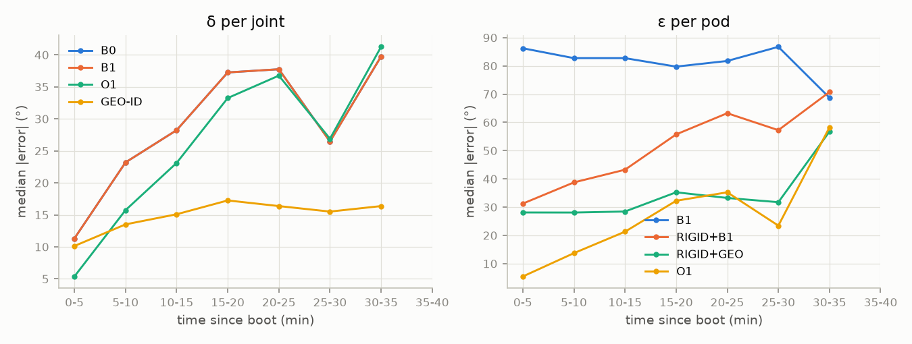

# Step 3 results: the twin, its data, and the numbers to beat (test split)

> **Twin `5de4440cd537`, AMASS motion.** Twin parameters: 2 fitted, 10 measured, 2 datasheet, 5 firmware, 59 assumption. Every number below is a twin number unless it says otherwise; the seven recordings are described, not tested.

Run: 2026-11-21T15:02:49; commit bdf77e75de17491318d3564ca3bddfd47ecee1d7+dirty; HIDA-4227519 (arm64, Python 3.11.16); 5 workers; 4038 s.

## 1. The calibration (S3-M6)

ABC by rejection (Beaumont et al. 2002) on the calibration recordings: 200 prior draws, the closest 20 kept (distance: MAD-scaled RMS over the core statistics; best 2.02, median 2.46).

| parameter | prior | posterior median | 90 % interval | width vs prior |
|---|---|---|---|---|
| `twin.sensors.gyro_bias_sigma_deg_per_min` | [0.02, 2.0] | 0.1152 | 0.0255 – 0.618 | 77 % |
| `twin.sensors.gyro_bias_walk_deg_s_sqrt_s` | [0.0001, 0.1] | 0.001825 | 0.0001393 – 0.01389 | 74 % |
| `twin.sensors.gyro_scale_max` | [0.0, 0.03] | 0.01937 | 0.002702 – 0.02833 | 95 % |
| `twin.fusion.vqf_tau_acc_s` | [0.1, 10.0] | 1.892 | 0.3567 – 7.684 | 74 % |
| `step1:error_model.box_slot_deg` | [0.5, 30.0] | 4.042 | 0.5585 – 16.4 | 92 % |
| `twin.wire.json_decimals` | choice | {'2': 1, '3': 3, '4': 8, '5': 5, '6': 3} | – | – |
| `twin.wire.json_decimals@suit_2026_11_04` | choice | {'2': 8, '3': 2, '4': 2, '5': 1, '6': 7} | – | – |
| `twin.procedure.p_limb_restart` | [0.0, 1.0] | 0.3967 | 0.08213 – 0.8719 | 88 % |
| `twin.procedure.p_zero_at_start` | [0.0, 1.0] | 0.7494 | 0.212 – 0.9298 | 80 % |
| `twin.procedure.p_camera_mismatch` | [0.0, 1.0] | 0.5801 | 0.1109 – 0.8534 | 82 % |

**Predictive checks** (every recording, core statistics inside the 90 % posterior predictive interval): twin 26 of 42, Step 1's simulator 14 of 42.

**Classifier two-sample test** (real 10 s BVH windows against simulated ones, leave one recording out): AUC twin 0.366 (0.312 – 0.419), Step 1 0.656 (0.603 – 0.707).

**Gate G-T** passes: the twin covers at least as many core statistics as Step 1's simulator, and its AUC is not higher.

## 2. The data (S3-M7)

| split | subjects | sessions | hours | draws per subject | old suit | no HipsAlt |
|---|---|---|---|---|---|---|
| train | 173 | 519 | 152.3 | 3 | 49 % | 16 % |
| val | 37 | 74 | 26.4 | 2 | 46 % | 15 % |
| test | 36 | 72 | 21.7 | 2 | 38 % | 19 % |

88 files, 19.42 GB; `MANIFEST.csv` SHA-256 `f65b7ee61cea591c…`; feature version 1; drawn from the calibration `twin_calibration_g4a03aeb-dirty`.

**Coverage** (training windows of 18 s whose 10 s loss regions tile each session, per pod or joint type × motion type × time since boot): 864 strata, 743 under 1,000. The least-covered unit per cell:

| motion | 0-5 min | 15-35 min | 5-15 min |
|---|---|---|---|
| arm | 2 | 7 | 12 |
| arm_forward | 6 | 0 | 0 |
| bend | 9 | 18 | 36 |
| jump | 1 | 4 | 2 |
| kick | 5 | 0 | 2 |
| leg_side | 6 | 0 | 0 |
| leg_swing | 3 | 0 | 0 |
| other | 4482 | 5060 | 7984 |
| preparation | 526 | 0 | 0 |
| squat | 7 | 0 | 0 |
| stairs | 35 | 6 | 62 |
| still | 1730 | 2088 | 3060 |
| tpose | 217 | 183 | 345 |
| turn | 101 | 52 | 93 |
| turn_spot | 3 | 0 | 0 |
| walk | 163 | 168 | 205 |

## 3. The numbers to beat (§8.1, §8.2)

Every test session of the dataset (72 sessions of 36 held-out subjects, 2,504,962 steps of 32 Hz) simulated again from its seed and conditions. |wrap(θ̂ − θ)| in degrees on valid steps outside the `transition` blends, pooled over steps and units (medians exact to the 0.02° histogram bin). ¹ uses simulator truth.

### 3.1 δ per joint

| method | median | mean | P95 | median 2-DoF | median 3-DoF | median hinge | coverage 68 % / 95 % |
|---|---|---|---|---|---|---|---|
| B0 | 23.13 | 43.62 | 151.25 | 25.63 | 21.35 | 22.67 | – |
| B1 | 23.13 | 43.62 | 151.25 | 25.63 | 21.35 | 22.67 | – |
| O1 ¹ | 16.43 | 38.45 | 147.25 | 18.63 | 15.41 | 14.51 | – |
| O2 ¹ | 0.01 | 0.00 | 0.01 | 0.01 | 0.01 | 0.01 | – |
| GEO-ID | 13.61 | 29.64 | 123.25 | 16.07 | 13.37 | 10.41 | 27 % / 44 % |

### 3.2 ε per pod (relative to the phone)

| method | median | mean | P95 | median HipsAlt (the root link) | coverage 68 % / 95 % |
|---|---|---|---|---|---|
| B0 | 83.25 | 86.81 | 171.75 | 74.75 | – |
| B1 | 83.25 | 86.81 | 171.75 | 74.75 | – |
| O1 ¹ | 14.31 | 37.61 | 148.75 | 0.01 | – |
| O2 ¹ | 0.01 | 0.00 | 0.01 | 0.01 | – |
| RIGID+B1 | 43.25 | 60.24 | 165.25 | 9.37 | – |
| RIGID+GEO | 29.69 | 50.17 | 159.75 | 9.37 | 34 % / 53 % |

Per pod (median):

| method | Head | Spine | HipsAlt | LeftArm | LeftForeArm | LeftHand | RightArm | RightForeArm | RightHand | LeftUpLeg | LeftLeg | LeftFoot | RightUpLeg | RightLeg | RightFoot |
|---|---|---|---|---|---|---|---|---|---|---|---|---|---|---|---|
| B1 | 83.25 | 86.75 | 74.75 | 83.25 | 75.25 | 76.25 | 84.25 | 84.75 | 91.25 | 85.75 | 88.75 | 76.75 | 87.75 | 80.75 | 87.25 |
| RIGID+B1 | 35.75 | 36.75 | 9.37 | 50.25 | 45.25 | 54.25 | 47.75 | 54.75 | 53.75 | 43.75 | 46.25 | 59.75 | 49.25 | 48.25 | 49.25 |
| RIGID+GEO | 24.51 | 24.85 | 9.37 | 38.75 | 37.75 | 51.25 | 30.25 | 35.25 | 47.25 | 27.91 | 25.23 | 35.25 | 28.85 | 31.75 | 32.75 |

### 3.3 Strata (median)

**time since boot (min)**

| since_boot_min | δ B1 | δ GEO-ID | ε RIGID+B1 | ε RIGID+GEO | n (δ B1) |
|---|---|---|---|---|---|
| 0-5 | 11.31 | 10.13 | 31.25 | 28.11 | 7821798 |
| 15-35 | 35.75 | 16.73 | 58.75 | 34.25 | 8149629 |
| 5-15 | 25.49 | 14.13 | 40.75 | 28.23 | 12352997 |

**motion type**

| motion | δ B1 | δ GEO-ID | ε RIGID+B1 | ε RIGID+GEO | n (δ B1) |
|---|---|---|---|---|---|
| bend | 15.65 | 6.45 | 13.73 | 13.29 | 84840 |
| other | 25.21 | 14.69 | 44.75 | 31.25 | 18875001 |
| preparation | 3.91 | 3.91 | 88.75 | 88.75 | 908492 |
| stairs | 22.93 | 6.31 | 20.47 | 12.87 | 73128 |
| still | 24.19 | 13.91 | 41.75 | 28.41 | 6788162 |
| tpose | 20.25 | 12.57 | 50.75 | 36.75 | 834625 |
| turn | 19.25 | 7.15 | 17.19 | 10.69 | 145800 |
| walk | 17.89 | 7.87 | 15.57 | 8.99 | 614376 |

**slip**

| slip | δ B1 | δ GEO-ID | ε RIGID+B1 | ε RIGID+GEO | n (δ B1) |
|---|---|---|---|---|---|
| camera_mismatch | 9.15 | 9.49 | 14.07 | 15.23 | 414734 |
| none | 13.83 | 10.45 | 24.81 | 21.89 | 2469391 |
| restarted | 37.25 | 26.13 | 65.75 | 61.75 | 3350425 |
| restarted+camera_mismatch | 58.25 | 35.75 | 95.75 | 88.75 | 2566873 |
| restarted+tree_mismatch | 6.43 | 10.81 | 12.61 | 17.07 | 396165 |
| restarted+zero_at_start | 37.25 | 17.53 | 57.75 | 29.53 | 5013263 |
| restarted+zero_at_start+camera_mismatch | 16.99 | 11.53 | 23.95 | 22.81 | 2156092 |
| tree_mismatch | 20.65 | 13.39 | 21.97 | 21.33 | 1136690 |
| zero_at_start | 20.99 | 11.39 | 39.25 | 26.39 | 5999216 |
| zero_at_start+camera_mismatch | 9.53 | 7.73 | 26.57 | 18.33 | 4097159 |
| zero_at_start+tree_mismatch | 22.41 | 22.41 | 54.25 | 54.25 | 724416 |

**suit version**

| suit | δ B1 | δ GEO-ID | ε RIGID+B1 | ε RIGID+GEO | n (δ B1) |
|---|---|---|---|---|---|
| suit_2026_11_13 | 22.65 | 14.45 | 30.75 | 25.73 | 7994266 |
| suit_2026_11_14 | 23.33 | 13.37 | 48.75 | 32.75 | 20330158 |

**wire mode**

| wire | δ B1 | δ GEO-ID | ε RIGID+B1 | ε RIGID+GEO | n (δ B1) |
|---|---|---|---|---|---|
| binary16 | 23.33 | 13.37 | 48.75 | 32.75 | 20330158 |
| json | 22.65 | 14.45 | 30.75 | 25.73 | 7994266 |

**HipsAlt present**

| hipsalt | δ B1 | δ GEO-ID | ε RIGID+B1 | ε RIGID+GEO | n (δ B1) |
|---|---|---|---|---|---|
| False | 23.13 | 19.79 | 90.75 | 91.25 | 5480610 |
| True | 23.13 | 12.71 | 29.93 | 21.09 | 22843814 |

### 3.4 Paired contrasts over subjects (§8.5)

Each held-out subject's mean error per method; the difference a − b; 10,000 bootstrap resamples of the subjects; Holm across the four contrasts.

| contrast (degrees) | subjects | mean | 95 % interval | p | p (Holm) |
|---|---|---|---|---|---|
| delta: B1 − B0 | 36 | -0.00 | -0.00 – +0.00 | 0.2302 | 0.2302 |
| delta: GEO-ID − B1 | 36 | -13.40 | -17.36 – -9.52 | 0.0001 | 0.0004 |
| eps: RIGID+B1 − B1 | 36 | -27.77 | -37.61 – -18.91 | 0.0001 | 0.0004 |
| eps: RIGID+GEO − RIGID+B1 | 36 | -9.69 | -13.26 – -6.38 | 0.0001 | 0.0004 |

### 3.5 The twin ablations (§8.1)

The same sessions built with Step 1's segment frames instead of surface frames, and with Step 1's analytic heading model instead of VQF in the loop (median, degrees):

| twin | δ B0 | δ B1 | δ O1 ¹ | ε B1 | ε RIGID+B1 | ε O1 ¹ |
|---|---|---|---|---|---|---|
| the twin (surface frames, VQF) | 23.13 | 23.13 | 16.43 | 83.25 | 43.25 | 14.31 |
| segment frames | 22.83 | 22.81 | 15.97 | 83.75 | 37.75 | 14.15 |
| analytic fusion | 10.39 | 10.43 | 5.45 | 90.75 | 24.89 | 4.61 |

## 4. Through the page (§8.3)

12 held-out test sessions (the first draw of each of the first 12 test subjects) with Nov 14's slips forced: both left-leg pods restarted after the box, the phone zeroed at Start, the velvet tree, HipsAlt present, the new suit. Each pod reading turned by its estimate at its arrival (so at the T-pose too); the phone never turned; drawn by the page twin; measured by the recordings' own code. Errors are drawn minus truth, degrees (median over the sessions that walk of the absolute error; a session that never walks has no Φ3 or Φ7). Φ3 is the shin's swing axis against the drawn hips' facing.

| variant | |Φ3| left shin | |Φ3| right shin | both shins within ±15° | shins disagree | |Φ7| | Φ7 within ±20° | drawn root height (cm) |
|---|---|---|---|---|---|---|---|
| `as_is` alone | 34.3 | 37.2 | 2 of 12 | 29.7 | 24.3 | 5 of 12 | 102 |
| `as_is` + RIGID+B1 | 58.1 | 55.3 | 0 of 12 | 28.2 | 64.6 | 1 of 12 | 102 |
| `as_is` + O2 | 31.4 | 34.9 | 2 of 12 | 9.8 | 35.4 | 4 of 12 | 102 |
| `ideal_root_box` + O2 | 31.4 | 34.9 | 2 of 12 | 9.8 | 35.9 | 5 of 12 | -4 |

The same sessions and slips, but the phone zeroed in the T-pose on the belt, as the procedure asks:

| variant | |Φ3| left shin | |Φ3| right shin | both shins within ±15° | shins disagree | |Φ7| | Φ7 within ±20° | drawn root height (cm) |
|---|---|---|---|---|---|---|---|
| `as_is` alone | 34.3 | 37.2 | 2 of 12 | 29.7 | 4.9 | 12 of 12 | 98 |
| `as_is` + RIGID+B1 | 58.0 | 55.4 | 0 of 12 | 28.0 | 63.6 | 1 of 12 | 98 |
| `as_is` + O2 | 12.5 | 5.8 | 7 of 12 | 8.2 | 2.0 | 12 of 12 | 98 |
| `ideal_root_box` + O2 | 12.5 | 5.8 | 7 of 12 | 8.2 | 1.9 | 12 of 12 | -4 |

**Reading it.** Every correction adds the page's constant turn between the phone's frame and a pod's (-90° for velvet's maps, `PHONE_TO_POD_RAD`). Turned to the phone's north (O2), all pods share one world, so the two shins agree with each other ('shins disagree'). The drawing is right when, in that world, the wearer faced the page's forward at the T-pose, which the phone's Zero in the T-pose arranges: then the true ε brings the shins close to the truth. Zeroed at Start, in the hand, the phone's north is wherever the hand pointed, and every pod corrected to the phone inherits it (Φ7 too): no correction relative to the phone fixes a phone zeroed away from the wearing pose. RIGID+B1 turns every pod by the root link's estimate (B1's box registration carries no information when the pods boot in the box): the legs keep their own norths, the drawing turns as a whole, and Φ3 and Φ7 both get worse.

## 5. What no heading correction fixes

A heading correction turns each pod about the vertical. It cannot undo the page's halved root (the hips settle at x* = (100·p + c)/2 because `initialPosition` aliases the hips' own position: a page defect, drawn the same with every method above), nor a mirrored tree map (a reflection is not a rotation about the vertical). Both need the page fixed, not a better estimate. Nor can a correction relative to the phone fix a phone zeroed away from the wearing pose (§4): the phone's Zero sets the drawing's north.

## 6. The retro path's "before" measures (§8.4, on the recordings: descriptive)

Φ3 is the drawn shin's swing direction against the travel (axial, degrees); the truth is OptiTrack's on Nov 13 and absent on Nov 14. These are what a corrected redraw would be measured against; the BVH-to-virtual-pod converter, `twin_v1_bvh` and the before-and-after command (a Should) are not built yet.

| recording | Φ3 left shin | Φ3 right shin | truth left | truth right | Φ7 | root height (cm) |
|---|---|---|---|---|---|---|
| nov13_1341 | -30.51 | 20.58 | 13.91 | -1.87 | -24.82 | 65.83 |
| nov13_1342 | -75.25 | 45.77 | 28.92 | 10.07 | -15.99 | 77.50 |
| nov13_1344 | -61.09 | 49.37 | 10.28 | -0.49 | -10.87 | 82.50 |
| nov13_1347 | -53.66 | 67.28 | 19.16 | -14.59 | -9.35 | 82.00 |
| nov13_1359 | -33.33 | 17.30 | 1.25 | -3.95 | -6.26 | 83.29 |
| nov14 | 71.91 | 8.95 | – | – | 63.67 | 116.40 |
