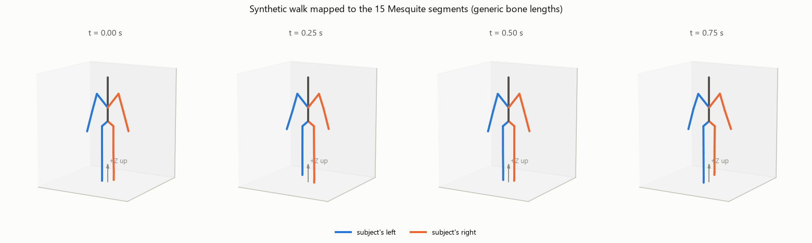
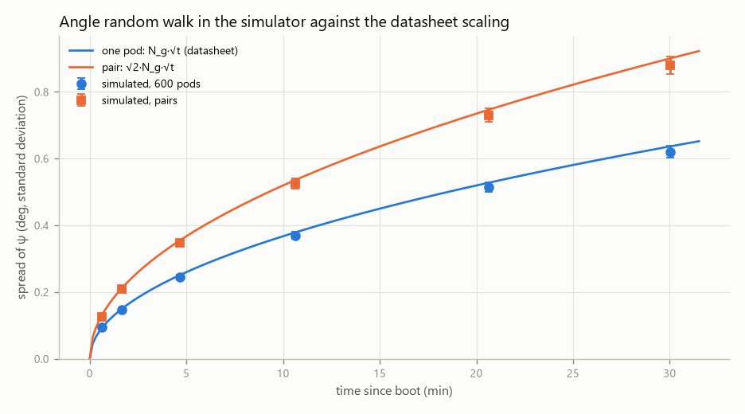
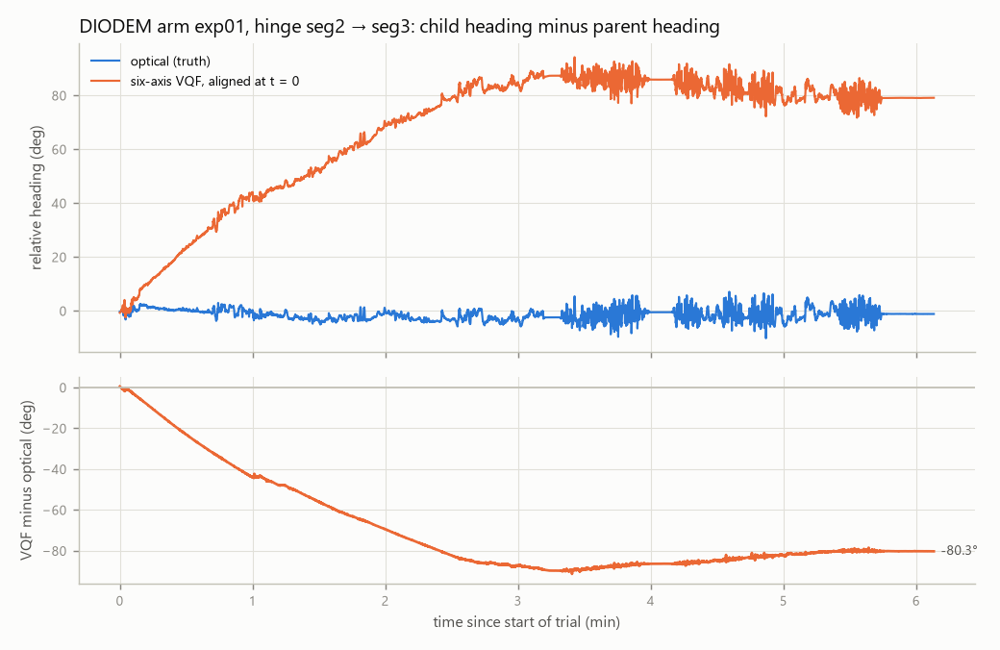

# Validation

*Generated by `python scripts/validate.py` (run by `bash scripts/check_all.sh`). Do not edit by hand;*
*the text of each check lives in `mesqsim/validation.py`.*

**Latest run:** 2026-11-21 20:01 UTC, commit `dde134fd70e4` (the code that was checked; `+dirty` means uncommitted changes).

**Summary:** 69 passed, 0 failed, 0 skipped, of 69 checks.

| # | check | expected | latest result | status |
|---|---|---|---|---|
| 1.1 | Golden vector, both ways | aa550257ff3f01c0ff1fff5f3412cdab, and decoding returns the same fields | encoded aa550257ff3f01c0ff1fff5f3412cdab; decoded id/batt/count/ms_lo (2, 87, 4660, 43981) | pass |
| 1.2 | Saturation at ±32767 | +32767 and -32767, never -32768 | [32767, -32767, 32767, -32767, 32767, -32767] | pass |
| 1.3 | Battery clamped at 100 | 100, 100, 0 | [100, 100, 0] | pass |
| 1.4 | count and ms_lo wrap at 65,536 | 65535, 0, 1, 7 | count [65535, 0, 1, 7], ms_lo [65535, 0, 1, 7] | pass |
| 2.1 | Y(90°) maps +x to +y | (0, 1, 0) | (2.22e-16, 1, 0) | pass |
| 2.2 | heading(Y(α)·R) = wrap(heading(R) + α) | max error < 1e-9 rad | max error 1.78e-15 rad over 100000 orientations | pass |
| 2.3 | wrap into (-180°, 180°] | -170, 180, 180 | [-170.0, 180.0, 180.0] | pass |
| 2.4 | q and -q are the same rotation | max difference < 1e-12 | max difference 0.0e+00 | pass |
| 2.5 | Composition order pinned | +y -> +z (and -x for the swapped order) | Rz90·Rx90·y = [-0.0, 0.0, 1.0], Rx90·Rz90·y = [-1.0, 0.0, 0.0] | pass |
| 3.1 | The §4.4 worked example | δ = -7°, residual 0° with the right sign, 14° with the wrong sign | δ = -7.000000°, right sign 4.79e-15°, wrong sign 14.000000° | pass |
| 4.1 | A correction never changes tilt | max change < 1e-12 | max change 1.1e-15 | pass |
| 4.2 | Turning every pod's north by one Y(β) changes nothing observable | labels: max change < 1e-9°; B1: max change ≤ 0.5° | labels max change 1.0e-13°; B1 max change 0.0039° | pass |
| 4.3 | Turning one pod's north by Y(γ) moves only its joints, by exactly ±γ | l_hip +23°, l_knee −23°, every other joint 0 (to 1e-9°); other pods' frames identical | l_hip +23.000000°, l_knee -23.000000°, others 0; other pods' frames identical: True | pass |
| 5.1 | Zero corruption: B0 = 0 up to quantisation, O2 = 0 | heading error 0 for both; B0 orientation error ≤ 0.01° (P99) and < 0.02° (max) | heading max 0.0e+00°; B0 orientation P99 0.0082°, max 0.0098° | pass |
| 5.2 | Offsets only: B0 equals the offset differences, O2 = 0 | |B0 − |a_c − a_p|| < 0.02° at every step; O2 heading error exactly 0 | max |B0 − offset difference| 0.0081° (offset differences up to 179.5°); O2 heading max 0.0e+00° | pass |
| 5.3 | Offsets only (arbitrary, zero slot error): B1 = O1 = 0, B0 is not | B1 and O1 ≤ 0.01° (quantisation); B0 mean > 10° | max heading error B1 0.0034°, O1 0.0e+00°; B0 mean 90.8° | pass |
| 6.1 | Random walk only: σ of ψ at 600 s is 0.367°, of a pair 0.519° | within 5 % of 0.367° and 0.519° (15 % in quick mode) | σ ψ 0.3743° (expected 0.3674°, 4500 pods); σ pair 0.5249° (expected 0.5196°, 4200 pairs) | pass |
| 6.2 | Drift only: δ(t) = (b_c − b_p)·t exactly | max |δ − (b_c − b_p)·t| < 1e-9° over every step and joint | max deviation 2.5e-14° over 25410 labels; largest |δ| 1.94° | pass |
| 6.3 | One full turn with k = 1.5 % gives 5.4° | 5.4° within 5 % | Θ over the motion 360.000°; ψ change 5.4000° (expected 5.4°) | pass |
| 7.1 | Discarded fractions 0.36, 0.42, 0.47 at 50.1, 55, 60 Hz | within 5 % of 1 − 32/f (0.361, 0.418, 0.467) | 50.1 Hz: 0.3620 (expected 0.3613); 55 Hz: 0.4188 (expected 0.4182); 60 Hz: 0.4673 (expected 0.4667) | pass |
| 7.2 | Held frames: none without stalls; the expected rate with stalls | 0 held without stalls; held rate within 5 % of the expectation with stalls (10 % in quick mode) | stalls off: 0 held; stalls on: rate 0.02607 vs expected 0.02613 (45033 held in 1727535 sends) | pass |
| 7.3 | Step 0 unwraps ms_lo across ≥ 3 wraps | exact equality for every received frame | 113605 frames, up to 3.63 wraps, 0 mismatches | pass |
| 7.4 | Step 0's fresh, held and lost flags equal the truth | same set of (pod, epoch, tick); 0 flag mismatches; reboot epochs found | default: 31999 ticks (fresh 31381, held 0, lost 618), 0 reboots, 0 unmatched, 0 mismatches; stress: 31999 ticks (fresh 29716, held 789, lost 1494), 3 reboots, 0 unmatched, 0 mismatches | pass |
| 7.5 | Loss rate and burst length match the loss model | loss fraction and mean burst within 5 % of the parameters | (0.005, 1): rate 0.00503, burst 1.000; (0.02, 3): rate 0.01989, burst 2.967; (0.05, 10): rate 0.05084, burst 10.011 | pass |
| 8.1 | Same config and seed: identical bytes; another seed differs | seed 7 twice: identical SHA-256 for every file; seed 8: different frames | 5 files; seed 7 twice identical: True; seed 8 differs: True | pass |
| 9.1 | Splits by subject; TotalCapture held out; deterministic | no subject in two splits; CMU 14/3/3; every TotalCapture sequence in 'holdout'; identical output after shuffling | CMU {'test': 3, 'train': 14, 'val': 3}; TotalCapture ['holdout']; problems none; shuffle-invariant True | pass |
| 9.2 | The AMASS split manifest: no subject in two splits, hash unchanged | no problems; SHA-256 equal to the frozen value | 8143 sequences, subjects per split {'test': 36, 'train': 173, 'val': 37}; problems none; SHA-256 d36448adb767… frozen d36448adb767… | pass |
| 9.3 | Every window and variant of a sequence stays in its split | each source sequence has exactly one split; every session seed distinct | 24 sessions from 6 sequences; splits per sequence [1]; distinct seeds 24 | pass |
| 10.1 | Rest pose: every segment equals the facing | max angle between any segment and R_0 < 1e-9° | max angle 3.5e-14° over 20 facings | pass |
| 10.2 | One AMASS sequence gives 15 unit orientations | shape (N, 15, 4), all finite, |q| = 1 | Subject_11_F_10_poses.npz: 473 frames at 120 Hz, shape (473, 15, 4) | pass |
| 10.3 | AMASS world is +Z up | closest world axis +Z, mean cosine > 0.8 | axis [0.0, 0.0, 1.0], mean cosine 0.962 | pass |
| 10.4 | Walking: left and right thighs alternate | correlation(left, right) < -0.3 | Walking_3_poses.npz: correlation -0.94 | pass |
| 10.5 | Knee flexion in an anatomical range | all frames within (-20°, 170°) | range [-8.9°, 156.1°] | pass |
| 11.1 | DIODEM files match the manifest | 267 of 267 files ok | 267 of 267 files ok | pass |
| 11.2 | DIODEM rate 40 Hz, quaternion norms 1 | IMU 40 Hz everywhere; max | |q| - 1 | < 1e-6 | IMU rates [40.0] Hz; optical rates [30.0, 120.0] Hz; max | |q| - 1 | 4.4e-16 over 1199524 quaternions | pass |
| 11.3 | Six-axis relative heading drifts, optical stays bounded | |VQF − optical| at the end > 2 × its P95 over the first 5 s; optical relative heading spans < 180° | VQF − optical: end -80.3°, max |.| 91.4°, P95 first 5 s 1.84°; optical span 17.3° | pass |
| 12.1 | Baseline order: O2 = 0 ≤ O1 ≤ B1, and B0 ≫ B1 in the arbitrary mode | O2 = 0 ≤ O1 ≤ B1; B0 > 5 × B1 | O2 0.000°, O1 6.224°, B1 6.615°, B0 92.746° | pass |
| 21.1 | Contract: causal (deleting later frames changes nothing before) | identical bytes at every query time at or before each cut, for both estimators | 11052 query steps compared over 5 cuts × 2 estimators; 0 outputs differ | pass |
| 21.2 | Contract: deterministic (same inputs, identical bytes) | identical bytes | GEO-ID and GEO-K, two runs each: identical bytes True | pass |
| 21.3 | Contract: label-blind (GEO-ID identical with the labels deleted) | identical bytes | files left: frames.parquet, session.json; identical bytes True | pass |
| 22.1 | Hinge, exact: closed form, the 12°/5° example, the blind spot, and GEO-K through the pipeline | (a) |delta_hat - delta| < 1e-9 rad; (b) -7.000°; (c) I < 1e-12 and kappa = 0; (d) every knee window < 0.1° | (a) max error 8.9e-16 rad; (b) -7.0000°; (c) I 0.0e+00, kappa 0; (d) GEO-K knee windows: 38, max error 0.0144° | pass |
| 23.1 | Hinge likelihood: the spread of delta_hat matches 1/sqrt(kappa) | ratio within 10 % of 1 | spread 0.790°, predicted 0.799°, ratio 0.989 | pass |
| 24.1 | Axis identification: within 1° on noise-free hinge motion; a flipped axis is corrected or flagged | both axes within 1° in every trial; votes +1 / -1 / 0 as stated; GEO-ID's knee axes within 2° on the walk | noise-free: worst axis error 0.001° over 5 motions; sign votes as expected: True; GEO-ID on a simulated walk (fusion noise on): knee axes within 0.56° | pass |
| 25.1 | 2-DoF, exact: the constraint recovers delta; two equal minima are flagged ambiguous | |delta_hat - delta| < 1e-6 rad; the built case ambiguous with kappa = 0 | max error 5.0e-13 rad over 120 windows (0 ambiguous); built twin: ambiguous True, kappa 0, cost gap 0.0e+00 | pass |
| 26.1 | Range of motion: within 1° when the motion reaches the limits; almost no information inside them | (a) |delta_hat - delta| < 1°; (b) kappa < 3 (95 % interval wider than ±60°); (c) kappa = 0 | (a) max error 0.369° over 8 windows; (b) kappa 1.97 (95 % half-width 104°); (c) kappa 0 | pass |
| 27.1 | Filter: exact prediction, large-kappa limit, product update, reboot reset; GEO-ID = B1 without information | (a) relative error < 1e-9 and the mean unchanged; (b) within 1 %; (c) identical; (d) kappa = 0; (e) never worse | (a) max relative error 4.4e-16, mean unchanged True; (b) max 0.302 % off; (c) identical True; (d) 3 reboots, 3 checked before the next window, kappa 0: True; (e) GEO-ID minus B1 error at most +0.0e+00° | pass |
| 28.1 | Invariances of GEO: one common yaw, one pod's yaw, tilt (brief §5.9) | (a) every output within 0.5°; (b) each joint's change within 0.5° of its expected value; (c) < 1e-12 | (a) common 73°: max change 0.1272° (GEO-ID and GEO-K); (b) pod 9 by 23°: max deviation from ±γ / 0 0.0043°; (c) tilt change 1.1e-16 | pass |
| 29.1 | Ordering with drift on, fusion noise off, known axes: O2 = 0 ≤ GEO-K ≤ B1 at every hinge | O2 = 0 ≤ GEO-K ≤ B1 at both knees | l_knee: O2 0.000°, GEO-K 6.349°, B1 21.301°; r_knee: O2 0.000°, GEO-K 5.470°, B1 18.210° | pass |
| 30.1 | Coverage on validation after recalibration: 68 % and 95 % per joint type | every coverage a number in [0, 1] | 12 sessions, 68 % / 95 % coverage: hinge 0.833 / 1.000; 2dof 0.721 / 0.843; 3dof 0.716 / 0.981 | pass |
| 31.1 | Timing: differential timing error of the parent/child pairs | max |error| ≤ 15 ms under the default config; P50 and P95 reported | default: 260939 pairs, P50 2.91 ms, P95 7.79 ms, max 12.73 ms; stress (stalls): P95 7.97 ms, max 19.10 ms | pass |
| 32.1 | DIODEM: files, the truth's sign, and GEO-ID against the optical truth on one hinge | (a) 267 of 267 files ok; (b) 30.000°, -7.000°; (c) GEO-ID's median error below the start registration's | (a) 267 of 267 files ok; (b) psi 30.000°, delta -7.000°; (c) GEO-ID median 15.18° (P95 29.63°, first information after 3.0 s) against 80.71° for a perfect registration at the start (end 80.7°) | pass |
| 33.1 | Reproducibility: the same config and seed give an identical RESULTS_STEP2.md apart from its Run line | identical apart from the Run line | 282 lines compared; identical apart from the Run line: True | pass |
| 40.1 | The page twin draws what the page draws (Step 3 brief §4.10) | quaternions within 1e-5, BVH numbers within 1e-4, the BVH header identical | 8 scenarios, 7802 messages: largest quaternion or hips difference 6.7e-16, largest BVH number difference 9.2e-14, headers identical True | pass |
| 40.2 | A twin BVH opens in the page's own BVHLoader as the page's own BVH does (Step 3 brief, S3-M5) | the twin's constructor and as-written parse behave as the real file's; stripped, 27 bones and one keyframe per BVH frame, all finite | twin: constructed False (Class constructor Loader cannot be invoked without 'new'); parsed as written False (Cannot read properties of undefined (reading 'trim'), 3 ';' lines); stripped: 27 bones, 2012 keyframes of 2012 frames, finite True; the Nov 14 BVH behaves identically | pass |
| 41.1 | What a pod's sensors feel: the four exact cases of Step 3 brief §4.3 | (a) ω = 0, f = Rᵀ(0, 0, 9.81) within 1e-9; (b) ω equals the spin within 1e-6 rad/s; (c) f = 0 within 1e-6; (d) the centripetal force within 1e-4 relative; (e) amplitude 0.5 ± 0.05 at the cutoff | (a) 4.4e-14; (b) 3.0e-12 rad/s; (c) 4.7e-08 m/s²; (d) 1.6e-06 relative; (e) amplitude 0.500 at the cutoff | pass |
| 42.1 | The chip's fusion in the loop meets its analytic expectations (Step 3 brief §4.5) | (a) ψ constant within 1e-6°; (b) ψ(t) = -b t within 1 %; (c) ψ = -k · 3 · 360° within 1 %; (d) Step 1's ψ within 1e-12 rad | vqf6d: (a) range 2.8e-13°, tilt 6.6e-11°; (b) -29.991° against -29.991° (7.4e-15); (c) -10.800° against -10.8° (1.0e-14); mahony: (a) range 3.6e-13°, tilt 2.2e-13°; (b) -29.991° against -29.991° (1.0e-14); (c) -10.800° against -10.8° (1.6e-14); (d) 15 pods, worst 8.9e-16 rad | pass |
| 43.1 | The heading labels: one twist rule (Step 3 brief §4.5, §4.11) | ψ = 12° exactly; ψ recovered within 1e-12 rad and no tilt; the split order-free within 1e-12 rad | hand check 12.000000000000°; ψ recovered within 8.9e-16 rad (tilt 3.1e-16); both orders within 8.9e-16 rad, the swing's angle within 9.4e-15 rad | pass |
| 43.2 | δ and ε recomputed from ψ match the twin's tables (Step 3 brief §10, item 4) | both within 1e-12 rad | 42877 tick labels, ε within 0.0e+00 rad; 3316 steps × 14 joints, δ within 0.0e+00 rad | pass |
| 44.1 | The wire, both suits (Step 3 brief §4.6) | the golden bytes and message exactly; every JSON number within half a step of the float32 report | golden frame aa550257ff3f01c0ff1fff5f3412cdab (equal), parsed message equal; JSON worst error / half step: 2 decimals 0.999, 3 decimals 0.999, 4 decimals 1.000, 5 decimals 1.000, 6 decimals 0.999 | pass |
| 44.2 | The old wire's fitted decimals and Nov 4's exact repeats (Step 3 brief §10, item 5) | the median over the seeds within 5 points of Nov 4's 85.6 % | suit_2026_11_04, json_decimals 2: twin Φ8 [77.3, 86.5, 99.8] %, median 86.5 %, against Nov 4's 85.6 % | pass |
| 45.1 | The phone app as its Swift code, 95 bytes, and the page's zero guard (Step 3 brief §4.7) | no difference from Swift (0 ulps); no message over 95 bytes; 0.0004, -0.0004, 0, -0 sent as 0.001, -0.001, 0.001, 0.001; the hips never move on a position with a 0, as on the page (1e-5) | port vs Swift: 1260 frames, 2110 encodes, 410 conversions, 4 lever fits, 0 differences, 0 ulps; 10000 random poses, longest 95 bytes; nudged ['0.001', '-0.001', '0.001', '0.001']; velvet: 27 of 90 positions with a 0, hips held True, largest difference from the page 4.4e-16; smooth: 27 of 90 positions with a 0, hips held True, largest difference from the page 4.4e-16 | pass |
| 46.1 | What cannot be known, as tests (Step 3 brief §4.12) | (a) every ψ and ψ_ph shifted by -β, δ and ε unchanged, within 1e-9 rad; (b) ψ_i and ε_i shifted by -γ, l_knee's δ by -γ and l_ankle's by +γ, everything else unchanged; (c) nothing changes; B1 and GEO-ID within 0.5° | (a) ψ shift 8.9e-16, ψ_ph shift 8.9e-16, ε 1.8e-15, δ 1.3e-15 rad; (b) the shin 8.9e-16, ε 1.8e-15, δ 1.3e-15, joints moved ['l_ankle', 'l_knee'], others 0.0e+00; (c) ψ 0.0e+00, δ 0.0e+00, phone lines equal True; estimators under (a): B1 0.0033°, GEO-ID 0.2475° | pass |
| 47.1 | Long sessions join smoothly (Step 3 brief §4.9) | no transition speed above the P99 | protocol: 29 pieces, 189.9 s, 28 joins, at most 2.47 rad/s on a blend against a P99 of 2.88; random: 9 pieces, 70.4 s, 8 joins, at most 2.71 rad/s on a blend against a P99 of 2.88 | pass |
| 48.1 | The same seed gives identical session files (Step 3 brief §10, item 9) | 9 files, every hash equal | 9 files, identical True | pass |
| 48.2 | The same seed gives an identical dataset manifest; --extend only appends (Step 3 brief §10, item 9) | identical manifests; after the extension the stored shards' hashes unchanged, two more draws of the same composition, and the dataset verifies | 4 files (4 sessions), manifests identical True; extended x2: 6 sessions, training draws [0, 1, 2, 3] of 1 composition, 3 stored shards unchanged True, verifies True | pass |
| 49.1 | The analysis of 2026-11-14 is reproduced (Step 3 brief §5.3) | every value reproduced or listed with its reason in mesqsim.real.recordings.EXPLAINED_DIFFERENCES | 48 of 62 reference values within tolerance; 14 explained differences | pass |
| 50.1 | The dataset: manifest, splits, windows, and features equal to a streaming recomputation (Step 3 brief §10, item 11) | every rule holds; the recomputed session identical, its streamed features equal to the stored rows | tiny: 4 sessions, 4 files, bad hashes 0, subjects in two splits 0, problems 0; recomputed and streamed identical True; twin_v1: 665 sessions, 88 files, bad hashes 0, subjects in two splits 0, problems 0; recomputed and streamed identical True | pass |
| 51.1 | The model kit: C5, Zeros = B0, Cheat caught, the loss references, Danyal's tests skip cleanly (Step 3 brief §10, item 12) | (a) within 1e-6 (float32 storage); (b) identical, causality 0; (c) Zeros unchanged, Cheat cannot run; (d) within 1e-6 relative; (e) no failure (each skips until its module exists) | (a) 3316 steps, largest change 2.9e-11 (x_pod 2.9e-11, x_joint 0.0e+00, x_phone 1.5e-16, x_pod_phone 0.0e+00), states equal True; (b) Zeros = B0 True (median 6.49°), causality 0.0e+00 rad; (c) Zeros label-free True, Cheat error 0.00° with labels, runs without them False; (d) loss references within 3.5e-14; (e) Danyal's tests: {'skipped': 10}; modules absent ['loader', 'models', 'loss', 'train'] | pass |
| 52.1 | RIGID: the 7° example, exact recovery, blind about the vertical (Step 3 brief §10, item 13) | (a) C = 0.992546, S = 0.121869, ε̂ = 7.000°; (b) within 1e-9 rad, vertical rates equal; (c) κ = 0 | (a) C 0.992546, S 0.121869, ε̂ 7.000000000°; (b) worst 8.9e-16 rad, vertical RMS 5.9e-15; (c) κ 0.0 | pass |

## What each check does and why

### 1.1 Golden vector, both ways

- **What:** Encode id 2, batt 87, (x, y, z, w) = (0.5, -0.5, 0.25, 0.75), count 0x1234, ms_lo 0xABCD; decode it back.
- **Why:** The codec must match the firmware frame byte for byte, or nothing decoded later can be trusted.
- **Expected:** aa550257ff3f01c0ff1fff5f3412cdab, and decoding returns the same fields
- **Command:** `pytest tests/test_codec.py -k golden`

### 1.2 Saturation at ±32767

- **What:** Quantise ±1.0, ±1.5 and ±1e9.
- **Why:** int16 can hold -32768, but the firmware saturates symmetrically; an off-by-one here flips signs.
- **Expected:** +32767 and -32767, never -32768
- **Command:** `pytest tests/test_codec.py -k saturation`

### 1.3 Battery clamped at 100

- **What:** Encode battery values 150, 100, -5.
- **Why:** The frame field is 0-100 percent.
- **Expected:** 100, 100, 0
- **Command:** `pytest tests/test_codec.py -k battery`

### 1.4 count and ms_lo wrap at 65,536

- **What:** Encode count = ms_lo = 65535, 65536, 65537 and 3·65536 + 7.
- **Why:** Both fields are uint16 on the wire; Step 0 must unwrap them.
- **Expected:** 65535, 0, 1, 7
- **Command:** `pytest tests/test_codec.py -k wrap`

### 2.1 Y(90°) maps +x to +y

- **What:** Rotate the unit x vector by Y(90°).
- **Why:** Pins the sign of Y(α): right-handed about world +Z.
- **Expected:** (0, 1, 0)
- **Command:** `pytest tests/test_conventions.py -k y90`

### 2.2 heading(Y(α)·R) = wrap(heading(R) + α)

- **What:** Random orientations with |pitch| < 80° and random α; also heading equals scipy's first intrinsic Z-Y-X angle.
- **Why:** Every heading quantity in the project (targets, box registration) relies on this identity.
- **Expected:** max error < 1e-9 rad
- **Command:** `pytest tests/test_conventions.py -k heading`

### 2.3 wrap into (-180°, 180°]

- **What:** wrap(190°), wrap(-180°), wrap(180°).
- **Why:** The interval is half-open; -180° and 180° must not both appear.
- **Expected:** -170, 180, 180
- **Command:** `pytest tests/test_conventions.py -k wrap`

### 2.4 q and -q are the same rotation

- **What:** Compare the rotation matrices and headings of random q and -q.
- **Why:** The wire canonicalises to w ≥ 0; nothing downstream may depend on the sign.
- **Expected:** max difference < 1e-12
- **Command:** `pytest tests/test_conventions.py -k minus_q`

### 2.5 Composition order pinned

- **What:** quat_mul(Rz90, Rx90) applied to +y; and quat_mul(a, b)·v = a·(b·v).
- **Why:** Composition reads right to left; swapping the order is the most common silent bug.
- **Expected:** +y -> +z (and -x for the swapped order)
- **Command:** `pytest tests/test_conventions.py -k composition`

### 3.1 The §4.4 worked example

- **What:** Parent at the root with ψ_p = 12°, child ψ_c = 5°. δ = wrap(ψ_c − ψ_p); correct with Y(+δ) and with the wrong sign Y(−δ); measure the residual rotation against Y(−12°)·s_c·m_c.
- **Why:** A sign error in the correction is invisible in most plots but leaves twice the error.
- **Expected:** δ = -7°, residual 0° with the right sign, 14° with the wrong sign
- **Command:** `pytest tests/test_correction.py -k worked_example`

### 4.1 A correction never changes tilt

- **What:** Apply random corrections Y(c_i) to random orientations; compare world-up expressed in body axes.
- **Why:** A heading correction acts about the vertical only; changing tilt would corrupt what gravity measured.
- **Expected:** max change < 1e-12
- **Command:** `pytest tests/test_correction.py -k tilt`

### 4.2 Turning every pod's north by one Y(β) changes nothing observable

- **What:** Simulate the same session twice (default config, seed 2), the second time with β = 73° added to every pod's north; compare the labels and B1's estimates (Step 0 box registration on the re-simulated frames).
- **Why:** The room's heading is unknowable (brief §2, §4.5): labels must not move, and estimators may only move by quantisation.
- **Expected:** labels: max change < 1e-9°; B1: max change ≤ 0.5°
- **Command:** `pytest tests/test_validation.py -k check_4_2`

### 4.3 Turning one pod's north by Y(γ) moves only its joints, by exactly ±γ

- **What:** Re-simulate with γ = 23° added to the LeftUpLeg pod's north (pod 9, child of l_hip, parent of l_knee).
- **Why:** Each pod's north enters only the joints it touches: as child +γ, as parent −γ (brief §4.5).
- **Expected:** l_hip +23°, l_knee −23°, every other joint 0 (to 1e-9°); other pods' frames identical
- **Command:** `pytest tests/test_validation.py -k check_4_3`

### 5.1 Zero corruption: B0 = 0 up to quantisation, O2 = 0

- **What:** Preset 'zero' (no offsets, exact timing): simulate a 20 s synthetic walk, decode, score B0 and O2.
- **Why:** With nothing to correct, any error left is a pipeline bug; only int16 quantisation may remain.
- **Expected:** heading error 0 for both; B0 orientation error ≤ 0.01° (P99) and < 0.02° (max)
- **Command:** `pytest tests/test_sim_slice.py -k zero_corruption`

### 5.2 Offsets only: B0 equals the offset differences, O2 = 0

- **What:** Preset 'offsets_only' (arbitrary offsets a_i, nothing else): B0's orientation error through the decoded frames against |wrap(a_c − a_p)|; O2's heading error.
- **Why:** The M3 end-to-end slice: frames, Step 0 and the metric agree with the analytic answer.
- **Expected:** |B0 − |a_c − a_p|| < 0.02° at every step; O2 heading error exactly 0
- **Command:** `pytest tests/test_sim_slice.py -k 'offset_differences or o2_error'`

### 5.3 Offsets only (arbitrary, zero slot error): B1 = O1 = 0, B0 is not

- **What:** Preset 'offsets_only': score B0, B1 and O1 over the motion phase.
- **Why:** Box registration recovers arbitrary offsets exactly when the box slots are perfect; nothing else may leak in.
- **Expected:** B1 and O1 ≤ 0.01° (quantisation); B0 mean > 10°
- **Command:** `pytest tests/test_validation.py -k check_5_3`

### 6.1 Random walk only: σ of ψ at 600 s is 0.367°, of a pair 0.519°

- **What:** Preset 'zero' plus the datasheet angle random walk (0.015 °/s/√Hz); idle chosen so that 600 s after each pod's boot falls in the motion phase; ψ over 4,500 pods (600 in quick mode) and over the 14 parent-child pairs.
- **Why:** Pins the random walk's scaling σ = N_g √t (datasheet: 0.367° after 10 min, √2 × for a pair).
- **Expected:** within 5 % of 0.367° and 0.519° (15 % in quick mode)
- **Command:** `pytest tests/test_validation.py -k check_6_1`

### 6.2 Drift only: δ(t) = (b_c − b_p)·t exactly

- **What:** Preset 'zero' plus drift (σ_b = 1 °/min), all pods booted at t = 0 (boot spread 0); compare every label δ(t_k) with (b_c − b_p)·t_k from the drawn b_i.
- **Why:** Pins the drift term's sign, units (deg/min) and time origin.
- **Expected:** max |δ − (b_c − b_p)·t| < 1e-9° over every step and joint
- **Command:** `pytest tests/test_validation.py -k check_6_2`

### 6.3 One full turn with k = 1.5 % gives 5.4°

- **What:** Synthetic walk in a circle at 30 °/s for exactly 360°; set the pelvis pod's scale factor to 1.5 %; ψ change of that pod over the motion, through the simulator's integration of the vertical angular velocity.
- **Why:** Pins Θ (signed rotation about the vertical) and the scale-factor term: 0.015 × 360° = 5.4° (brief §4.3).
- **Expected:** 5.4° within 5 %
- **Command:** `pytest tests/test_validation.py -k check_6_3`

### 7.1 Discarded fractions 0.36, 0.42, 0.47 at 50.1, 55, 60 Hz

- **What:** One pod, 600 s, decode delay 0-11 ms, no stalls: share of chip samples that are never sent.
- **Why:** The pod sends the newest sample at each 32 Hz send; the rest are discarded (brief §3.3): 1 − 32/f.
- **Expected:** within 5 % of 1 − 32/f (0.361, 0.418, 0.467)
- **Command:** `pytest tests/test_validation.py -k check_7_1`

### 7.2 Held frames: none without stalls; the expected rate with stalls

- **What:** Stalls off: 15 pods at rates spread over 50.1-60 Hz, 600 s each. Stalls on (S = 100 ms every 3 s ± 0.5 s): 15 pods for 3,600 s (1,200 s in quick mode); expected held per stall = (S + E[u])/T − 1 with T = 31.25 ms and E[u] = 1/(2f) + f·D²/12 the mean time since the last decode (D = 11 ms decode spread).
- **Why:** Held frames come only from stalls (brief §3.3); their rate must follow from the stall model, not from a bug.
- **Expected:** 0 held without stalls; held rate within 5 % of the expectation with stalls (10 % in quick mode)
- **Command:** `pytest tests/test_validation.py -k check_7_2`

### 7.3 Step 0 unwraps ms_lo across ≥ 3 wraps

- **What:** Simulate 200 s of standing (about 238 s of recording, over 3 wraps of 65.536 s); compare Step 0's unwrapped ms_lo with the pod clock at each true decode time.
- **Why:** ms_lo wraps every 65.536 s; a wrong unwrap shifts every later sample time by a minute.
- **Expected:** exact equality for every received frame
- **Command:** `pytest tests/test_sim_slice.py -k three_wraps`

### 7.4 Step 0's fresh, held and lost flags equal the truth

- **What:** Join Step 0's series with the simulator's per-tick labels on (pod, epoch, tick) and compare every flag, under the default config and under the stress preset (5 % loss in bursts of 10, 100 ms stalls, reboots; seed 5 has three reboots), both with a 10-minute idle gap.
- **Why:** Step 0 is the shared decoder of real recordings; its bookkeeping must be exact where the truth is known.
- **Expected:** same set of (pod, epoch, tick); 0 flag mismatches; reboot epochs found
- **Command:** `pytest tests/test_validation.py -k check_7_4`

### 7.5 Loss rate and burst length match the loss model

- **What:** The Gilbert-Elliott chain alone, 2,000,000 sends, at the brief's sweep corners (0.5 %, 1), (2 %, 3), (5 %, 10).
- **Why:** The loss model's two parameters must mean what their names say.
- **Expected:** loss fraction and mean burst within 5 % of the parameters
- **Command:** `pytest tests/test_validation.py -k check_7_5`

### 8.1 Same config and seed: identical bytes; another seed differs

- **What:** Simulate a 5 s synthetic walk three times (seeds 7, 7, 8), write each session, hash every file.
- **Why:** A run must be reproducible from (commit, config hash, seed) alone.
- **Expected:** seed 7 twice: identical SHA-256 for every file; seed 8: different frames
- **Command:** `pytest tests/test_sim_slice.py -k same_seed`

### 9.1 Splits by subject; TotalCapture held out; deterministic

- **What:** Split a synthetic AMASS-like file list (CMU 20 subjects, KIT 3, SFU 1, TotalCapture 5; 2 sequences each), shuffle the rows and split again.
- **Why:** Leakage between splits would make every later comparison optimistic (brief §5.1).
- **Expected:** no subject in two splits; CMU 14/3/3; every TotalCapture sequence in 'holdout'; identical output after shuffling
- **Command:** `pytest tests/test_splits.py`

### 9.2 The AMASS split manifest: no subject in two splits, hash unchanged

- **What:** Read manifests/split_manifest.csv; check it; compare its SHA-256 with the frozen manifests/split_manifest.sha256.
- **Why:** After Danyal freezes the split, any change to it must be deliberate and visible.
- **Expected:** no problems; SHA-256 equal to the frozen value
- **Command:** `python -m mesqsim split`

### 9.3 Every window and variant of a sequence stays in its split

- **What:** Generate a small dataset (synthetic sources, 2 windows, 2 variants per window) and read its dataset.csv.
- **Why:** Windows of one sequence are near-duplicates; if they straddled splits, test data would leak into training.
- **Expected:** each source sequence has exactly one split; every session seed distinct
- **Command:** `pytest tests/test_splits.py -k variant`

### 10.1 Rest pose: every segment equals the facing

- **What:** Zero every local rotation, give the root an upright pose with a random facing, run the forward kinematics and the mapping.
- **Why:** At the SMPL rest pose (a T-pose) every global rotation equals R_0; this is the simulated T-pose.
- **Expected:** max angle between any segment and R_0 < 1e-9°
- **Command:** `pytest tests/test_amass.py -k rest_pose`

### 10.2 One AMASS sequence gives 15 unit orientations

- **What:** Load the first AMASS motion file and map it.
- **Why:** The loader must handle the release's keys and frame rate; every segment must come out finite and unit.
- **Expected:** shape (N, 15, 4), all finite, |q| = 1
- **Command:** `pytest tests/test_amass.py -m amass -k 15_orientations`

### 10.3 AMASS world is +Z up

- **What:** Over up to 20 sequences, average the pelvis's body up axis (SMPL +y) in world coordinates.
- **Why:** Every dataset is converted to the +Z-up world at load time; for AMASS that conversion is the identity, which this verifies from the data rather than assuming it.
- **Expected:** closest world axis +Z, mean cosine > 0.8
- **Command:** `pytest tests/test_amass.py -m amass -k z_up`

### 10.4 Walking: left and right thighs alternate

- **What:** Hip flexion (thigh relative to pelvis about the lateral axis) on the first AMASS file named 'walk'.
- **Why:** Left and right must be the subject's own sides; swapped or mirrored legs would still look like walking but would correlate positively.
- **Expected:** correlation(left, right) < -0.3
- **Command:** `pytest tests/test_amass.py -m amass -k thighs_alternate`

### 10.5 Knee flexion in an anatomical range

- **What:** Knee flexion (shin relative to thigh about the lateral axis) over up to 50 sequences, both sides.
- **Why:** A wrong joint index or axis would produce impossible knees.
- **Expected:** all frames within (-20°, 170°)
- **Command:** `pytest tests/test_amass.py -m amass -k knee`

### 11.1 DIODEM files match the manifest

- **What:** Verify size and SHA-256 of every file in manifests/diodem.csv (downloads were checked against the Dataverse MD5 when fetched).
- **Why:** The sanity check is only meaningful on the published data.
- **Expected:** 267 of 267 files ok
- **Command:** `python scripts/check_env.py --require diodem`

### 11.2 DIODEM rate 40 Hz, quaternion norms 1

- **What:** Read the header of every IMU and optical CSV; compute every optical quaternion's norm.
- **Why:** Confirms the format the loader assumes before any analysis.
- **Expected:** IMU 40 Hz everywhere; max | |q| - 1 | < 1e-6
- **Command:** `pytest tests/test_diodem.py -m diodem -k rates`

### 11.3 Six-axis relative heading drifts, optical stays bounded

- **What:** Arm trial exp01 (all 13 motions, 6.1 min), hinge seg2 -> seg3, rigid IMUs: six-axis VQF (magnetometer dropped) against optical truth. Figure: docs/figures/diodem_relative_heading.png.
- **Why:** Reproduces, on real sensors, the phenomenon the project corrects. No claims are drawn from it in Step 1.
- **Expected:** |VQF − optical| at the end > 2 × its P95 over the first 5 s; optical relative heading spans < 180°
- **Command:** `python scripts/make_figures.py`

### 12.1 Baseline order: O2 = 0 ≤ O1 ≤ B1, and B0 ≫ B1 in the arbitrary mode

- **What:** Default config (arbitrary offsets) with a 10-minute idle; mean heading error over the motion phase, averaged over 10 sessions of a 20 s synthetic walk (3 in quick mode).
- **Why:** Oracles bound the honest baseline from below; without box registration arbitrary offsets dominate.
- **Expected:** O2 = 0 ≤ O1 ≤ B1; B0 > 5 × B1
- **Command:** `pytest tests/test_validation.py -k check_12_1`

### 21.1 Contract: causal (deleting later frames changes nothing before)

- **What:** Default config, 20 s synthetic walk with a 10-minute idle; for GEO-ID and GEO-K, cut the frames table at 5 host times (box, T-pose, three in the motion), decode the cut recording with Step 0, re-run the estimator and compare every output (delta, kappa, uncertain) at the query times up to the cut.
- **Why:** An estimate at time t may use only frames that arrived at or before t (brief rule 9); a real-time display cannot see the future.
- **Expected:** identical bytes at every query time at or before each cut, for both estimators
- **Command:** `pytest tests/test_geo_contract.py -k causal`

### 21.2 Contract: deterministic (same inputs, identical bytes)

- **What:** Run GEO-ID and GEO-K twice on the same series, session and query times; compare the bytes of every output.
- **Why:** Results must be reproducible from (commit, config, seed); a random start or set ordering would break it.
- **Expected:** identical bytes
- **Command:** `pytest tests/test_geo_contract.py -k deterministic`

### 21.3 Contract: label-blind (GEO-ID identical with the labels deleted)

- **What:** Write a simulated session folder, run GEO-ID; delete labels_ticks.parquet, labels_joints.parquet and meta.json; read the folder as a real recording (frames and session.json only), run GEO-ID again.
- **Why:** A deployable estimator must run on the real suit, which has no labels (brief rule 7).
- **Expected:** identical bytes
- **Command:** `pytest tests/test_geo_contract.py -k label_blind`

### 22.1 Hinge, exact: closed form, the 12°/5° example, the blind spot, and GEO-K through the pipeline

- **What:** (a) 500 random hinge windows (random delta, axis, mountings, poses, 1-40 pairs), no noise; (b) h = x horizontal with psi_p = 12°, psi_c = 5°; (c) a vertical axis; (d) GEO-K on a simulated 20 s walk with every error off except arbitrary offsets and drift (preset zero, offsets arbitrary, drift 0.2 °/min): every knee window's estimate against the true delta at the window end (the window solver through frames, Step 0, clock and pairs).
- **Why:** Exact data must give the exact answer; (d) catches m against m^-1 (pod -> segment) and frame-order bugs that would make GEO-K fail on clean data (brief §5.10).
- **Expected:** (a) |delta_hat - delta| < 1e-9 rad; (b) -7.000°; (c) I < 1e-12 and kappa = 0; (d) every knee window < 0.1°
- **Command:** `pytest tests/test_hinge.py`

### 23.1 Hinge likelihood: the spread of delta_hat matches 1/sqrt(kappa)

- **What:** One window's hinge geometry (40 pairs) with independent Gaussian noise (sigma 0.05 per component), 2,000 Monte Carlo draws: the circular RMS spread of delta_hat against the RMS of the predicted 1/sqrt(kappa).
- **Why:** Verifies the formula kappa = I/sigma_hat^2 (the exact von Mises likelihood), not the real noise: correlated residuals are handled by the fitted kappa scale.
- **Expected:** ratio within 10 % of 1
- **Command:** `pytest tests/test_hinge.py -k likelihood`

### 24.1 Axis identification: within 1° on noise-free hinge motion; a flipped axis is corrected or flagged

- **What:** Five noise-free synthetic hinge motions (parent tumbling, child flexing; random mountings and private norths): fit u_p, u_c from body rates (Seel et al. 2014). Then deliberately flip u_c: the vertical rule must vote to flip back when the axis leaves the horizontal, and abstain when it stays horizontal; the T-pose rule must vote to flip back for a horizontal knee axis. Also GEO-ID through the pipeline: its knee axes on a simulated walk.
- **Why:** A wrong axis or a wrong relative sign (180° error) would make GEO-ID's hinge worse than nothing (brief §5.10).
- **Expected:** both axes within 1° in every trial; votes +1 / -1 / 0 as stated; GEO-ID's knee axes within 2° on the walk
- **Command:** `pytest tests/test_hinge.py -k 'identified or flipped'`

### 25.1 2-DoF, exact: the constraint recovers delta; two equal minima are flagged ambiguous

- **What:** 120 random universal-joint windows (elbow, wrist and ankle axes; random delta, mountings, poses, private norths), no noise, known axes: delta_hat against delta. Then a built case with j1 horizontal and gamma = 90°, where the vertical terms vanish and delta, delta + 180° fit equally well.
- **Why:** Exact data must give the exact answer; the 180° twin must never be reported with confidence (brief §5.5).
- **Expected:** |delta_hat - delta| < 1e-6 rad; the built case ambiguous with kappa = 0
- **Command:** `pytest tests/test_twodof_rom.py -k 'twodof or ambiguous'`

### 26.1 Range of motion: within 1° when the motion reaches the limits; almost no information inside them

- **What:** Noise-free hip windows (Cardan XZY; 120 samples; random delta, mountings, pelvis facing): (a) axial rotation sweeping its whole allowed range ±40° against the box [-10°, 60°] x [-10°, 10°] x [-40°, 40°]; (b) a ±10° sweep against a wide box [-90°, 120°] x [-60°, 60°] x [-90°, 90°] that it never reaches; (c) no box at all.
- **Why:** At ball joints the only clue is the joint limit; where the motion stays inside, kappa must stay near 0 instead of inventing confidence (brief §5.6).
- **Expected:** (a) |delta_hat - delta| < 1°; (b) kappa < 3 (95 % interval wider than ±60°); (c) kappa = 0
- **Command:** `pytest tests/test_twodof_rom.py -k rom`

### 27.1 Filter: exact prediction, large-kappa limit, product update, reboot reset; GEO-ID = B1 without information

- **What:** (a) Beliefs left alone for 1 s to 600 s: the mean stays and A(kappa) = A(kappa0)·exp(-q·dt/2); (b) kappa0 = 5e4: kappa against (1/kappa0 + q·dt)^-1; (c) one update against the closed-form product; (d) the stress preset, seed 5 (reboots), 10-minute idle: at the first query after the host learns of each reboot, before the next window, kappa of every joint of that pod; (e) noise-free standing (preset zero, arbitrary offsets): GEO-ID's error against B1's at every motion step.
- **Why:** The filter is the estimator's memory; a reboot gives the pod a new north, so its joints must forget (brief §5.7). With nothing to learn, GEO-ID must not do worse than box registration (S2-M4).
- **Expected:** (a) relative error < 1e-9 and the mean unchanged; (b) within 1 %; (c) identical; (d) kappa = 0; (e) never worse
- **Command:** `pytest tests/test_filter.py`

### 28.1 Invariances of GEO: one common yaw, one pod's yaw, tilt (brief §5.9)

- **What:** Default config, 20 s synthetic walk, 10-minute idle, seed 2. (a) Re-simulate with β = 73° added to every pod's north: GEO-ID and GEO-K over the motion; (b) with γ = 23° added to pod 9 (LeftUpLeg): every joint's change against +γ for l_hip, −γ for l_knee and 0 elsewhere; (c) GEO-ID's chain corrections applied to every pod's reports: the world-up direction in each pod's frame before and after.
- **Why:** North and the room's heading are unknowable; an estimator that depends on them, or lets one pod's north leak into other joints, is broken (Step 1 brief §4.5).
- **Expected:** (a) every output within 0.5°; (b) each joint's change within 0.5° of its expected value; (c) < 1e-12
- **Command:** `pytest tests/test_validation.py -k check_28_1`

### 29.1 Ordering with drift on, fusion noise off, known axes: O2 = 0 ≤ GEO-K ≤ B1 at every hinge

- **What:** Default config with drift 1 °/min, fusion tilt error 0 and a 10-minute idle; mean primary error over the motion at each knee, averaged over 4 sessions of a 20 s synthetic walk (2 in quick mode).
- **Why:** With exact tilt and known axes the hinge geometry sees the drift that box registration cannot (brief §8 item 9).
- **Expected:** O2 = 0 ≤ GEO-K ≤ B1 at both knees
- **Command:** `pytest tests/test_validation.py -k check_29_1`

### 30.1 Coverage on validation after recalibration: 68 % and 95 % per joint type

- **What:** GEO-ID with the configured (fitted) calibration on the validation sessions of the synthetic stand-in dataset (seed 1; 2 sequences and 12 sessions; quick: 1 sequence): the share of motion-phase steps whose error lies inside the central 68 % and 95 % von Mises intervals of the reported kappa, per joint type. The AMASS validation numbers come from `python -m mesqsim fit-geometry calibration --source amass` and docs/RESULTS_STEP2.md.
- **Why:** Confidence is only useful if it is calibrated (H5); the brief asks that the numbers exist here and treats the ±5-point target as a result, not a check.
- **Expected:** every coverage a number in [0, 1]
- **Command:** `python -m mesqsim fit-geometry calibration --source synthetic`

### 31.1 Timing: differential timing error of the parent/child pairs

- **What:** Default config, 30 s synthetic walk with a 10-minute idle (3 seeds; 1 in quick mode): every pair GEO-ID formed, joined to the labels on (pod, epoch, tick): the child's true time at the slerp point minus the parent's true sample time. Also reported, not tested: the stress preset (100 ms sample-task stalls).
- **Why:** The geometry compares two pods at one instant; the pods' clocks differ, and ms_lo is the decode time, 0-11 ms after the sample (Step 1 brief §3.3). Bound tested: 15 ms = the 11 ms decode-delay spread + 4 ms for the clock fit. After a stall a sample is decoded up to one chip period late, so stress can exceed it.
- **Expected:** max |error| ≤ 15 ms under the default config; P50 and P95 reported
- **Command:** `pytest tests/test_geo_contract.py -k pair_timing`

### 32.1 DIODEM: files, the truth's sign, and GEO-ID against the optical truth on one hinge

- **What:** (a) Every DIODEM file against manifests/diodem.csv; (b) the truth's sign on a synthetic rotation: q_vqf = Y(-psi)·q_opt with psi = 30° must give psi = -heading(q_vqf·q_opt^-1) = 30°, and psi_p = 12°, psi_c = 5° must give delta = -7°; (c) GEO-ID, unchanged, on arm exp01, hinge seg2 -> seg3 (6.1 min, rigid IMUs, six-axis VQF at 40 Hz, no box, no T-pose), against the optical relative heading; regenerates docs/figures/diodem_geo_hinge.png.
- **Why:** A reality check on real sensors whose north drifts (−80° in 6 min here): the geometry must track what a perfect registration at the start cannot. Out of distribution (mechanical chains): no claim about people.
- **Expected:** (a) 267 of 267 files ok; (b) 30.000°, -7.000°; (c) GEO-ID's median error below the start registration's
- **Command:** `python scripts/make_figures.py`

### 33.1 Reproducibility: the same config and seed give an identical RESULTS_STEP2.md apart from its Run line

- **What:** Run `scripts/make_results_step2.py --source synthetic --max-sequences 1 --no-sweeps --no-diodem` twice into temporary files (seed 1; 6 test sessions) and compare them line by line, except the line starting '**Run:**' (date, CPU, wall time and compute time live there and nowhere else).
- **Why:** Every table must be traceable to (commit, config, seed); worker scheduling, dictionary order or a random start must not change a number (brief §8 item 13).
- **Expected:** identical apart from the Run line
- **Command:** `python scripts/make_results_step2.py --source synthetic --max-sequences 1 --no-sweeps --no-diodem`

### 40.1 The page twin draws what the page draws (Step 3 brief §4.10)

- **What:** Replay the eight golden scenarios (a T-pose then a leg swing; a turn while the phone moves; HipsAlt silent for 2 s; the phone's positions holding exact zeros; each in the velvet and smooth trees) through mesqsim/twin/page.py and compare every drawn bone quaternion and hips position after each message, and every number of the recorded BVH, with what js/custom_icm.js and js/bvh_converter.js wrote when run unmodified in Node (tools/page_golden/run.mjs, three.js r157, the avatar glbs/scene2.glb, mesquite-mocap 87d7c3b).
- **Why:** The twin's BVH files are judged against Danyal's, so the twin must draw with the page's own rules, defects included; a port that agrees only on simple inputs would hide exactly the effects Step 3 studies.
- **Expected:** quaternions within 1e-5, BVH numbers within 1e-4, the BVH header identical
- **Command:** `pytest tests/test_page_twin.py; python tools/page_golden/make_fixtures.py (needs Node)`

### 40.2 A twin BVH opens in the page's own BVHLoader as the page's own BVH does (Step 3 brief, S3-M5)

- **What:** The short twin session's page/twin.bvh (a one-minute program of KIT subject 3 after the 35 s procedure) and Danyal's Nov 14 BVH, both through build-static/BVHLoader.js of mesquite-mocap 87d7c3b in Node (tools/page_golden/load_bvh.mjs): its constructor, its parse of the file as written, and its parse without the page's ';' provenance lines.
- **Why:** The twin's BVH must be the page's file format, readable wherever the page's own files are; at 87d7c3b the page's loader cannot be constructed on its three.js r157 and cannot read the page's own ';' lines, so the twin's file must fail in exactly the same way and parse, once those lines are removed, with every keyframe finite.
- **Expected:** the twin's constructor and as-written parse behave as the real file's; stripped, 27 bones and one keyframe per BVH frame, all finite
- **Command:** `pytest -m node tests/test_twin_session.py -k loader`

### 41.1 What a pod's sensors feel: the four exact cases of Step 3 brief §4.3

- **What:** mesqsim.twin.physics.imu_truth on synthetic motion sampled at 1 kHz with the interpolating spline: (a) a still pod; (b) a constant spin about a body axis; (c) free fall; (d) a site on a circle at constant speed; and (e) the smoothing spline's response at the cutoff (8 Hz, samples at 120 Hz).
- **Why:** ω and f are the twin's sensor inputs: a wrong frame, sign or derivative here reaches every pod's fusion, and no later statistic would reveal which.
- **Expected:** (a) ω = 0, f = Rᵀ(0, 0, 9.81) within 1e-9; (b) ω equals the spin within 1e-6 rad/s; (c) f = 0 within 1e-6; (d) the centripetal force within 1e-4 relative; (e) amplitude 0.5 ± 0.05 at the cutoff
- **Command:** `pytest tests/test_twin_body.py`

### 42.1 The chip's fusion in the loop meets its analytic expectations (Step 3 brief §4.5)

- **What:** VQF six-axis and Mahony at 55 Hz, their own bias estimation off, fed ideal samples (mesqsim.twin.sensors: the mean rate over each interval, gravity rotated in): (a) a pod turning about every axis, no sensor error; (b) a pod lying flat turning three times, a bias of 0.5 °/s on its vertical axis, 60 s; (c) the same turns with a 1 % scale error on that axis; (d) Step 1's simulator (its default config, η = 0) on synthetic:walk:10, its reports caught before the int16 quantisation and put through the twin's twist rule.
- **Why:** The twin replaces Step 1's analytic heading model by real filters; their heading must still follow the rules the analysis rests on, with the signs q = Y(-ψ) R fixes: a bias b gives ψ = -b t, a scale error k over a turn Θ gives ψ = -k Θ (Step 1's b_1 = -b, k_1 = -k), and no error gives a constant ψ.
- **Expected:** (a) ψ constant within 1e-6°; (b) ψ(t) = -b t within 1 %; (c) ψ = -k · 3 · 360° within 1 %; (d) Step 1's ψ within 1e-12 rad
- **Command:** `pytest tests/test_twin_fusion.py`

### 43.1 The heading labels: one twist rule (Step 3 brief §4.5, §4.11)

- **What:** mesqsim.twin.labels: ψ = -wrap(2 atan2(E_z, E_w)) of E = q R⁻¹ on the brief's hand check E = Y(-12°); on q = Y(-ψ) R for 1,000 random R and ψ; and on E = S T and E = T S for 1,000 random swings S about horizontal axes and twists T. The δ and ε tables are recomputed from ψ once the twin writes sessions (S3-M5).
- **Why:** Every pod's and the phone's heading label is this rule; a sign or order slip would move every δ and ε.
- **Expected:** ψ = 12° exactly; ψ recovered within 1e-12 rad and no tilt; the split order-free within 1e-12 rad
- **Command:** `pytest tests/test_twin_fusion.py -k 'twist or swing'`

### 43.2 δ and ε recomputed from ψ match the twin's tables (Step 3 brief §10, item 4)

- **What:** The short twin session: ε_i = wrap(ψ_i - ψ_ph) from labels_ticks' own ψ columns, and δ_pc = wrap(ψ_c - ψ_p) from labels_steps' per-pod ψ, against the stored eps_rad and labels_joints' delta_rad.
- **Why:** The scorer and Danyal's models read δ and ε; they must be exactly the twist-rule ψ the tables also carry.
- **Expected:** both within 1e-12 rad
- **Command:** `pytest -m amass tests/test_twin_session.py -k tables`

### 44.1 The wire, both suits (Step 3 brief §4.6)

- **What:** Step 1's golden frame (id 2, batt 87, q (0.5, -0.5, 0.25, 0.75), count 0x1234, ms_lo 0xABCD) through mesqsim.twin.wire, and the message the page's parser makes of it; the old dongle's JSON line at 2-6 decimals for 500 random reports each, parsed back. Nov 4's exact-repeat share with the fitted json_decimals is added when S3-M6 fits them.
- **Why:** The page draws what arrives: the twin's frames must be the pod's bytes and the old suit's lines the dongle's text, or every statistic of the page twin inherits the difference.
- **Expected:** the golden bytes and message exactly; every JSON number within half a step of the float32 report
- **Command:** `pytest tests/test_twin_wire.py tests/test_codec.py -k golden`

### 44.2 The old wire's fitted decimals and Nov 4's exact repeats (Step 3 brief §10, item 5)

- **What:** Nov 4's matching session (the static hold: KIT subject 3 still in his T-pose's stance) simulated as its suit version suit_2026_11_04 is configured (the JSON wire at the precision S3-M6 fitted on Nov 4, the pods its BVH shows), three seeds; its Φ8 (the share of still frames whose recorded rotation repeats exactly) against the recording's.
- **Why:** Φ8 is the wire's fingerprint in a BVH: if the old wire's decimals are right, a still twin repeats its frames as often as the still suit did.
- **Expected:** the median over the seeds within 5 points of Nov 4's 85.6 %
- **Command:** `pytest -m real tests/test_twin_calibration.py -k decimals`

### 45.1 The phone app as its Swift code, 95 bytes, and the page's zero guard (Step 3 brief §4.7)

- **What:** mesqsim.twin.phone_app against tests/fixtures/app_golden (the app's unmodified Core/*.swift at mesquite-mocap 87d7c3b, compiled by tools/app_golden): 1,260 pipeline frames, 2,110 encoded poses, 410 matrix conversions, 4 lever-arm fits. Then 10,000 uniformly random poses (boxes of ±5, ±50, ±500 m, and orientation only) through the port's encoder; the nudged zero; and the zero-guard scenarios of the page golden test replayed through the page twin.
- **Why:** The phone drives the drawn root; the twin's messages must be the app's to the byte, never exceed the hub's 95-byte record, and meet the page's habit of dropping a position that holds an exact 0.
- **Expected:** no difference from Swift (0 ulps); no message over 95 bytes; 0.0004, -0.0004, 0, -0 sent as 0.001, -0.001, 0.001, 0.001; the hips never move on a position with a 0, as on the page (1e-5)
- **Command:** `pytest tests/test_twin_phone.py tests/test_page_twin.py -k zero`

### 46.1 What cannot be known, as tests (Step 3 brief §4.12)

- **What:** The short twin session three more times: (a) every pod's report and the phone's messages turned by one Y(0.7 rad); (b) the left shin's report alone by Y(-0.4 rad); (c) the room's origin moved by (3, -2, 0) m. Then B1 and GEO-ID on (a) against the original.
- **Why:** No label and no estimator may depend on the world's or a pod's arbitrary north: ψ_i -> ψ_i - γ for a pod turned alone must move only ε_i and the δ of its own joints, with δ_pc = ψ_c - ψ_p giving -γ where it is the child and +γ where it is the parent.
- **Expected:** (a) every ψ and ψ_ph shifted by -β, δ and ε unchanged, within 1e-9 rad; (b) ψ_i and ε_i shifted by -γ, l_knee's δ by -γ and l_ankle's by +γ, everything else unchanged; (c) nothing changes; B1 and GEO-ID within 0.5°
- **Command:** `pytest -m amass tests/test_twin_session.py -k 'invariances or estimators'`

### 47.1 Long sessions join smoothly (Step 3 brief §4.9)

- **What:** The protocol program (KIT subject 3: 29 pieces, his clips and synthetic pieces on his poses) and a one-minute random program of the same subject: the largest angular speed of the root or any body joint's local rotation on a 0.5 s blend, against the P99 of the pieces' own speeds.
- **Why:** A join that whips a joint round would put accelerations and rates into the twin that no recording has.
- **Expected:** no transition speed above the P99
- **Command:** `pytest -m amass tests/test_twin_session.py -k program`

### 48.1 The same seed gives identical session files (Step 3 brief §10, item 9)

- **What:** The short twin session simulated twice with seed 3 and written by write_twin_session: the SHA-256 of every file (frames, the four label tables, phone.parquet, session.json, meta.json, page/twin.bvh). The dataset manifest's part of this check comes with the dataset (S3-M7).
- **Why:** Every result must be reproducible from its seed and config; a hidden clock, set order or unseeded draw would make the twin's numbers unrepeatable.
- **Expected:** 9 files, every hash equal
- **Command:** `pytest -m amass tests/test_twin_session.py -k seed`

### 48.2 The same seed gives an identical dataset manifest; --extend only appends (Step 3 brief §10, item 9)

- **What:** mesqsim.learn.store.generate twice with seed 5 on the tiny dataset of mesqsim.learn.checks (the first subject of each split; two training draws, one validation and one test draw; quarter-minute programs; a stand-in posterior), comparing MANIFEST.csv; then one copy extended by a factor of 2.
- **Why:** Every dataset must be reproducible from its seed and config, and growing it on demand (§6.3) must never change a session that a model has already been trained or scored on.
- **Expected:** identical manifests; after the extension the stored shards' hashes unchanged, two more draws of the same composition, and the dataset verifies
- **Command:** `pytest -m amass tests/test_learn_store.py -k manifest`

### 49.1 The analysis of 2026-11-14 is reproduced (Step 3 brief §5.3)

- **What:** Φ1-Φ12 of Danyal's seven recordings (mesqsim.real: the BVH and Motive readers, marker naming and following, the clock alignment, the statistics) against the 62 reference values of §5.3, each within its tolerance.
- **Why:** The twin will be judged by these statistics, so the code that measures them must first reproduce the analysis it inherits; every value it does not reproduce needs a written reason (Step 3 brief §5.3).
- **Expected:** every value reproduced or listed with its reason in mesqsim.real.recordings.EXPLAINED_DIFFERENCES
- **Command:** `python -m mesqsim real-stats; pytest -m real tests/test_real_recordings.py`

### 50.1 The dataset: manifest, splits, windows, and features equal to a streaming recomputation (Step 3 brief §10, item 11)

- **What:** mesqsim.learn.store.verify (every file re-hashed against MANIFEST.csv and none unlisted; no subject in two splits; ids unique; the nested parts on training subjects only; each session in one shard of its own split, contiguous on the 32 Hz grid, every per-step array of its length, so the reference windows of mesqsim.learn.store.windows never cross a session or a split and end with their loss region), then one session simulated again from its seed and conditions: its stored arrays against the new ones, and its features recomputed from only the frames and messages that had arrived at a quarter, a half and the end. On the tiny dataset of 48.2, and on twin_v1 under $MESQ_OUTPUT_DIR/datasets when it has been generated.
- **Why:** A loader, a model and the scorer rely on these rules; and a feature computed differently in the store than live would train a model on inputs it never meets.
- **Expected:** every rule holds; the recomputed session identical, its streamed features equal to the stored rows
- **Command:** `python -m mesqsim verify-dataset --name twin_v1; pytest -m amass tests/test_learn_store.py`

### 51.1 The model kit: C5, Zeros = B0, Cheat caught, the loss references, Danyal's tests skip cleanly (Step 3 brief §10, item 12)

- **What:** (a) C5: the short twin session's stored inputs (mesqsim.learn.features) against the same with every pod and the phone turned by one heading of 0.9 rad; (b) the dummy Zeros through mesqsim.learn.scorer against the built-in B0 on the tiny dataset's test split, every summary number and table cell; (c) Cheat on the same inputs with the labels deleted; (d) SciPy's von Mises -log density against -κ cos d + log 2π + log i0e(κ) + κ at 7 cases up to κ = 1e7; (e) tests/test_model_kit.py's tests of loader.py, models.py, loss.py and train.py, run by pytest.
- **Why:** A model is only as honest as its inputs and its scorer: an input that moved with a common heading, a scorer that scored nothing as something, or a test that broke before Danyal's code exists would each mislead the first trained model's numbers.
- **Expected:** (a) within 1e-6 (float32 storage); (b) identical, causality 0; (c) Zeros unchanged, Cheat cannot run; (d) within 1e-6 relative; (e) no failure (each skips until its module exists)
- **Command:** `pytest tests/test_model_kit.py tests/test_learn_features.py`

### 52.1 RIGID: the 7° example, exact recovery, blind about the vertical (Step 3 brief §10, item 13)

- **What:** mesqsim.learn.rigid.rigid on (a) ω = (1, 0, 0) rad/s seen by HipsAlt (ψ_h = 12°) and the phone (ψ_ph = 5°); (b) 20 random constant world rates, starting orientations and norths, noise-free; (c) a rotation about the vertical only.
- **Why:** RIGID links the phone to HipsAlt for the RIGID + B1 chain and for TCN-P-chain; its closed form must be exact where the geometry is, and say 'no information' where it is not.
- **Expected:** (a) C = 0.992546, S = 0.121869, ε̂ = 7.000°; (b) within 1e-9 rad, vertical rates equal; (c) κ = 0
- **Command:** `pytest tests/test_learn_rigid.py`

## Figures

*The same mapping on a synthetic walk (used until AMASS is downloaded): subject's left in blue, right in orange, +Z up.*

*Simulator, random walk only: spread of ψ for one pod and for parent-child pairs against the datasheet scaling N_g·√t (checks 6.1); error bars are ±1 standard error of the spread.*

*DIODEM arm exp01, hinge seg2 → seg3: six-axis VQF relative heading against optical truth (check 11.3). No claims are drawn from it in Step 1.*

*DIODEM arm exp01, hinge seg2 → seg3: GEO-ID (unchanged, from the six-axis IMUs only, no box, no T-pose) against the optical relative heading, with its 95 % interval, and a perfect registration at the start for comparison (check 32.1). Mechanical chain: out of distribution.*
